# Spec: Danh mục mặt hàng (DMATHANG) — pilot workflow Claude viết spec → Muse implement

- Trạng thái: **NHÁP — chờ Chiến duyệt** (chưa code)
- Ngày: 2026-11-21. Base: `main` @ `a1cb39f` (đã `git fetch origin main`, working tree sạch)
- Menu: **HOẠT ĐỘNG > Danh mục mặt hàng** (`SMENU` thứ tự `ZZZ004`, phím tắt `131149` = **Ctrl+M**). Chức năng quyền: `SFUNCTION` "Danh mục mặt hàng" (`9bcaf32e-e0c6-4b62-8ab4-65afb965bd2e`, nhóm "Bán hàng").
- Bảng chính `DMATHANG` (`STABLEDESC` `a4a16216-aee9-4dd3-9f92-c1e4d85c06a2`, `TABLETYPE = 2` = cây nhóm bên trái + lưới bên phải, `CATEGORYCOL = DNHOMMATHANGID`, `READONLY = 0`, `MUSTSELECTCATEGORY = 30`). Bảng liên quan: `DNHOMMATHANG` (nhóm, dạng cây), `DLOAIMATHANG`, `DLOAIDO`, `DGIAMATHANG`, `DDONVITINH`, `DDINHLUONG` (định lượng), `DHANGSANXUAT`, `DDOITACKYGUI`.

## 0. Nguồn, cách đọc, giới hạn

Quy ước nhãn nguồn trong spec (để Muse biết điều nào chắc, điều nào chưa):

- **[DB]** đo trực tiếp trên bản chép **chỉ đọc** của `POS TAP\Database\DATA.fdb` (không dùng `DEMO.FDB`). Chắc chắn.
- **[CODE]** đọc từ mã đã xuất trong `POS_TAP_SRC_EXPORT/STABLEDESC/DMATHANG__a4a16216/` (`code.cs`, `layout.xml`, `designcode.cs`), `DNHOMMATHANG__ee17d8ff/`, `SFORM/Lịch sử mua bán__7c40b8f7/`. Chắc chắn.
- **[FW]** suy ra từ **chuỗi tiếng Việt** còn đọc được trong `No1Lib.Sys.DLL` (framework dựng màn "bảng nhập liệu"; mã bị làm rối nên **không** đọc được luồng, chỉ đọc được chuỗi thông báo/SQL rời). Bằng chứng tốt nhưng chưa thấy hành vi thật — đánh dấu rõ ở từng chỗ.
- **[THUẬT TOÁN]** `DbUtils.GenMaHang` (`No1Lib.Sys.DLL`) đọc bằng decompile (mã bị làm rối bằng state machine nhưng các mảnh SQL và thứ tự xử lý lộ ra) — ghép lại ở mục 3.5, cần kiểm bằng app gốc (Q12).
- **[APP]** **quan sát trực tiếp trên app gốc POS TAP ngày 21/11/2026**: chạy một **bản sao** thư mục `POS TAP` (bỏ thư mục Backup) trong thư mục tạm, **không quyền admin**, tài khoản Admin, DB sao chép của `DATA.fdb`; thao tác bằng **script** (chụp màn hình + gửi chuột/phím), không bằng tay. Ảnh ở `docs/specs/img/danh-muc-mat-hang/`. Sau thao tác, **đọc lại DB của bản sao** để kiểm dữ liệu app ghi thật (3.1b). `DATA.fdb` gốc không bị đụng. Sau khi đóng bản sao, kiểm lại không còn tiến trình nào của nó.
- **[CHƯA XÁC MINH]** không có trong DB/mã/chuỗi/lần chạy thử; xếp vào mục 6.2 kèm kịch bản test và mặc định tạm.

**Giới hạn của lần quan sát [APP]:** (1) làm trên DB gần như trống: 1 nhóm và 2 mặt hàng do tôi tạo trong bản sao; chưa có hóa đơn/phiếu nên **chưa thử** chặn xóa khi còn tham chiếu; (2) cấu hình `SCONFIG` giữ nguyên như DB thật (giá 2/3/4, mã hàng, tên tiếng Anh, cân điện tử… **đều tắt**) nên chưa thấy giao diện khi chúng **bật**; (3) chưa thử quyền (chỉ có tài khoản Admin); (4) bản của người dùng chạy quyền admin nên không điều khiển được; chỉ chạy bản sao.

DB thật ít dữ liệu: `DMATHANG` chỉ có **1 dòng** (`ID = 'KM'`, "Khuyến mại tự động", `STATUS = 60`, mặt hàng hệ thống dùng cho dòng khuyến mại), `DNHOMMATHANG` **0 dòng**, `DDINHLUONG` 8 dòng mồ côi (tham chiếu mặt hàng không có). Không có số liệu phân bố thật; thư mục `POS TAP\Data\Backup\*.gbk` có dữ liệu cũ nhưng máy chưa có `gbak` để dựng lại (Q17).

Không sửa code, không đổi DB, không commit trong bước này.


## 1. Bố cục UI (y hệt app gốc)

### 1.1 Màn danh mục (khung "bảng nhập liệu" của framework) [APP]

Ảnh: `img/danh-muc-mat-hang/01` (màn trống), `08` (có dữ liệu). Trong app gốc **không có form riêng** cho danh sách: đây là màn chung dựng từ `STABLEDESC`/`SCOLUMN` (cùng khung với Danh mục khách hàng). Bản clone **đã có** khung chỉ-xem (`Kazuko_FnB.UI/CatalogView.cs` + `Kazuko_FnB.Data/CatalogRepository.cs`: cây nhóm, lưới, ô tìm F3, Làm mới). Spec này yêu cầu **thêm**: thêm/sửa/xóa (không sao chép: Chiến bỏ), dialog mặt hàng, dialog nhóm, theo quyền (mục 2, 4) **và đổi bộ cột lưới theo thực tế dưới đây**.

**Bố cục** (tab tài liệu "Danh mục mặt hàng" cạnh tab "Sử dụng dịch vụ"):
- **Trái — panel "Nhóm mặt hàng"** (rộng ≈ 245 px ở 96 DPI): thanh nút nhỏ **+** (thêm nhóm), **✎** (sửa nhóm; mờ khi chưa chọn nhóm). App gốc có thêm 4 nút phía sau (biểu tượng thư mục, nút đang sáng, làm mới, ▾ ở mép phải) và bánh răng ở tiêu đề panel — **bỏ hết (Chiến, 21/11/2026)**: bản mới chỉ có **hai nút + và ✎**, không bánh răng (Q2). Cây: **"Tất cả"** (biểu tượng quả địa cầu) · **"Chưa thiết lập"** (mặt hàng chưa có nhóm) · các **nhóm** (nhiều cấp, menu có "Thêm con"). *(App gốc còn nút "Thùng rác" ở cuối cây — **không làm**, Chiến 21/11/2026, mục 5.13.)*
- **Phải — tab "Mặt hàng"** với thanh nút: ô **Lọc (F3)**, **Thêm mới (Insert)**, **Chỉnh sửa (F4)**, **Xóa (Del)**, **Thêm excel**, **Xuất excel**, **Import định lượng**, **In**, **In mã vạch**. "Chỉnh sửa", "Xóa" **mờ** khi không có dòng chọn.
- **Dưới — panel hai tab:** **"Thông tin"** (Khởi tạo · Khởi tạo bởi · Sửa đổi gần nhất · Sửa đổi bởi — của dòng đang chọn) và **"Khu vực"** (lưới chỉ-xem, 13 cột, rỗng với mặt hàng thường — xem Q2).
- **Thanh trạng thái:** `CSDL: DATA.fdb`, `Tài khoản: Admin`, ô tích **Tự động tải lại**, ô tích **Gõ tiếng Việt** + kiểu gõ Telex (tính năng chung của chương trình).

**Cột lưới thật** (DB hiện tại, các cấu hình giá 2/3/4, mã hàng, mã sẵn có đang tắt; đã chụp). Rộng ≈ px ở 96 DPI:

| # | Tiêu đề | Rộng | Kiểu / ghi chú |
|---|---|---|---|
| — | (cột số thứ tự, có mũi tên dòng hiện hành) | ≈ 40 | |
| 1 | Tên mặt hàng | ≈ 141 | text |
| 2 | Nhóm mặt hàng | ≈ 213 | tên nhóm (lookup) |
| 3 | Loại mặt hàng | ≈ 130 | tên loại, có biểu tượng; **trống** khi `DLOAIMATHANGID = ''` |
| 4 | Đơn vị tính | ≈ 78 | tên ĐVT, có biểu tượng |
| 5 | Giá bán | ≈ 66 | số, định dạng `15,000`, canh phải |
| 6 | Giá nhập | ≈ 107 | số; chỉ người có quyền **Xem giá nhập** |
| 7 | Đơn vị tính chẵn | ≈ 80 | tên ĐVT chẵn |
| 8 | Quy đổi | ≈ 80 | số (hiện `0` khi trống) |
| 9 | Giá bán chẵn | ≈ 80 | số |
| 10 | Tạm khóa | ≈ 80 | ô tích |
| 11 | Giá theo thời giá | ≈ 80 | ô tích |

**Khác với `SGRID` trong DB:** `SGRID` của `DMATHANG` (CODE, NAME, DDONVITINHID, GIANHAP, MASANCO, GIABAN, DDOITACKYGUIID, HOAHONG hiện; TONTOIDA, TONTOITHIEU, GIABAN2, NOTE, GIAVON, DNHOMMATHANGID ẩn) **không khớp** bộ cột thật (thật có Nhóm, Loại, ĐVT chẵn, Quy đổi, Giá bán chẵn, Tạm khóa, Giá theo thời giá; **không** có Mã sẵn có, Đối tác ký gửi, Hoa hồng). `SGRID` có cột `MOBILE`; chưa rõ nó dùng cho giao diện nào. **Bản mới không dùng `SGRID` làm bố cục lưới desktop** (khung chỉ-xem hiện có của clone đang dùng `SGRID` cho `DMATHANG` → phải đổi sang bảng trên). Cột Mã hàng, Mã sẵn có, Giá 2/3/4, Tên tiếng anh: ẩn khi cấu hình tắt (suy ra từ ô dialog bị mờ; **cách thể hiện trên lưới khi bật cấu hình**: Q10). Cột có thể thêm/bớt bằng menu chuột phải "**Cột hiển thị**".

Lưới **chỉ đọc** (Q1 [APP]). Dòng chọn và ô hiện hành được tô nổi bật (màu do theme). Chỉ hiện mặt hàng `STATUS = 30`: mặt hàng hệ thống `KM` (`STATUS = 60`) và dòng `STATUS = 0` (do thùng rác của app gốc tạo ra) không hiện.

**Menu chuột phải** (ảnh 10, 11, 12):
- **Lưới:** Thêm Mặt hàng · Thêm nhanh (excel) · Cập nhật nhanh (excel) · Chỉnh sửa · Đặt giá trị · Lọc theo giá trị · Sắp xếp theo ▸ · Refresh · In danh sách · Sao chép ô · Sao chép vùng chọn · Xóa · Tự động dãn cột · Cột hiển thị · Thuộc tính (mục theo dòng chọn mờ khi không có dòng).
- **Nhóm:** Thêm mới ▸ · Thêm con ▸ · Chỉnh sửa · Sắp xếp theo ▸ · Refresh · ~~Sao chép~~ (bỏ, 5.14) · Mở rộng · Thu gọn · Xóa · Đổi tên · Biểu tượng · Thuộc tính.
- ~~Dòng trong Thùng rác: Khôi phục · Sắp xếp ▸ · Refresh · Sao chép · Xóa vĩnh viễn · Thuộc tính.~~ **Bỏ** (thùng rác không làm, Chiến 21/11/2026; ảnh 10 chỉ để tham khảo).

**Phím:** Ctrl+M mở màn · Insert thêm · F4 sửa · Del xóa (có xác nhận) · F3 lọc · nhấp đôi dòng = sửa.

**Nút `STABLEDESC`/framework còn lại** (có trên thanh nút, hành vi chưa thử — Q16): Thêm excel, Xuất excel, Import định lượng, In, In mã vạch (`BARCODEPRINT = 30`, `AUTOREPORT = 30`; `SREPORT` có "BÁO CÁO DANH MỤC", "DANH SÁCH MẶT HÀNG THEO NHÓM", "DANH SÁCH MẶT HÀNG THEO HÃNG SẢN XUẤT"). Có trong phạm vi v1 không: mục 5/Q16.

### 1.2 Dialog Thêm/Sửa mặt hàng

Kích thước nội dung **636 × 387** (UserControl; nhúng trong hộp thoại của framework), một **TabControl** 3 tab: **"Thông tin mặt hàng"**, **"Định lượng"**, **"Khác"**. Số liệu dưới đây lấy nguyên từ `layout.xml` [CODE] (96 DPI, tọa độ trong tab; Muse nhân theo `DeviceDpi / 96`).

**Tab 1 — "Thông tin mặt hàng"** (tab page 628×361):

| Tab# | Control gốc | Nhãn | Vị trí (x, y) | Kích thước | Trường DB | Ghi chú |
|---|---|---|---|---|---|---|
| 0 | `No1TextBox` `txtCODE` | Mã hàng (nhãn 7,10) | 118, 6 | 87×20 | `CODE` | Tự sinh theo nhóm (3.5); `SCOLUMN`: **bắt buộc, không trùng**; bật theo `SuDungMaHang` |
| 1 | `No1TextBox` `txtNAME` | **Tên hàng** (đậm; nhãn 7,36) | 118, 32 | 309×20 | `NAME` | **Bắt buộc**; trùng tên theo `ChoPhepTrungTenMatHang` (hiện = 0 → không cho trùng) |
| 2 | `No1TextBox` `txtTENTIENGANH` | Tên tiếng anh (7,61) | 118, 58 | 309×20 | `TENTIENGANH` | Bật theo `SuDungTenTiengAnh` (hiện = 0) |
| 3 | `No1NumericUpDown` `numGIABAN` | Giá bán (7,88) | 118, 84 | 86×20 | `GIABAN` | 2 chữ số thập phân, dấu phân cách nghìn, khoảng ±10¹² |
| 4 | `No1NumericUpDown` `numGIABAN2` | nhãn lấy từ cấu hình `DienGiaiGia2` (272,86) | 349, 84 | 78×20 | `GIABAN2` | Bật theo `SuDungGia2` (hiện = 0) |
| 5 | `No1NumericUpDown` `numGIABAN3` | Giá bán 3 (7,114) → `DienGiaiGia3` | 118, 110 | 86×20 | `GIABAN3` | Bật theo `SuDungGia3` (0) |
| 6 | `No1NumericUpDown` `numGIABAN4` | nhãn `DienGiaiGia4` (272,112) | 349, 112 | 78×20 | `GIABAN4` | Bật theo `SuDungGia4` (0) |
| 7 | `No1LookupEdit` `lueDDONVITINHID` | ĐVT bán, định lượng (7,139) | 118, 136 | 86×21 | `DDONVITINHID` | **Bắt buộc** (`AllowEmpty=False` trong layout); đổi giá trị → `UpdateQuyDoi` |
| 8 | `No1CheckBox` `chkGIATHEOTHOIGIA` | Giá theo thời giá | 349, 138 | 103×17 | `GIATHEOTHOIGIA` | |
| 9 | `No1LookupEdit` `lueDDONVITINHCHANID` | ĐVT nhập mua (7,166) | 118, 163 | 86×21 | `DDONVITINHCHANID` | Bật theo `SuDung2DonViTinh` (hiện = **30**, đang bật) |
| 10 | `No1NumericUpDown` `numQUYDOI` | Quy đổi (272,167) | 349, 164 | 38×20 | `QUYDOI` | Chỉ bật khi **cả hai** ĐVT được chọn, ngược lại = 0 và khóa; nhãn mô tả `lblChiTietQuyDoi` (393,167) = `"(1 {chẵn} = {quy đổi} {lẻ})"`, chỉ hiện khi cả hai ĐVT được chọn |
| 11 | `No1NumericUpDown` `numGIANHAP` | Giá nhập (7,192) | 118, 190 | 86×20 | `GIANHAP` | Nhãn đơn vị `lblDvtNhap` (210,192) = `"(/1 {ĐVT chẵn nếu có, không thì ĐVT lẻ})"`; ẩn khi không có quyền Xem giá nhập |
| 12 | `No1NumericUpDown` `numGIAVON` | Giá vốn (272,192) | 349, 190 | 78×20 | `GIAVON` | **Chỉ đọc**, không tab-stop, khoảng ±10¹⁶; quyền Xem giá nhập |
| 13 | `No1LookupEdit` `lueDNHOMMATHANGID` | Nhóm mặt hàng (7,216) | 118, 216 | 309×21 | `DNHOMMATHANGID` | **Bắt buộc** (`SCOLUMN.ALLOWEMPTY = NO`); đổi → sinh mã nếu là mặt hàng mới |
| — | nhãn `lblDLOAIMATHANGID` | **Loại mặt hàng** | 7, 246 | — | `DLOAIMATHANGID` | Nhóm 5 nút radio bên dưới (không có lookup trực tiếp) |
| 14 | `RadioButton` `rdMatHangPhaChe` | Mặt hàng pha chế | 118, 244 | 112×17 | → `'1'` | |
| 15 | `RadioButton` `rdMatHangKiemVatTu` | Mặt hàng kiêm vật tư | 118, 267 | 125×17 | → `'0'` | **Mặc định khi thêm mới** |
| 16 | `RadioButton` `rdVatTuNguyenLieu` | Vật tư nguyên liệu | 118, 290 | 110×17 | → `'2'` | |
| 17 | `RadioButton` `rdMatHangMo` | Mặt hàng mở | 118, 313 | 87×17 | → `'3'` | |
| 18 | `RadioButton` `rdKhac` | Khác | 118, 336 | 50×17 | → giá trị combo | |
| 19 | `No1LookupEdit` `lueDLOAIMATHANGID` | (không nhãn) | 210, 333 | 217×21 | `DLOAIMATHANGID` | **Chỉ hiện khi chọn "Khác"**; danh sách = `DLOAIMATHANG` loại trừ `ID` `0,1,2,3` → còn **Combo (4), Combo mở (5), Dịch vụ (6), Dịch vụ theo giờ (7)** |
| 20 | `No1NumericUpDown` `numGIOHATCOMBO` + nhãn "Giờ hát combo" (446,338 / 527,335, 59×20) | | | | `GIOHATCOMBO` | Chỉ hiện khi **có tiền giờ** (`CoTienGio`) **và** loại = Combo. POS TAP có `CoTienGio = 0` → **không bao giờ hiện** |
| — | `No1Picture` `ANH` | (ảnh) | 447, 10 | 175×149 (resize 128×128) | `ANH` (BLOB) | Ảnh mặt hàng. Cách chọn/xóa ảnh: Q9 |
| — | `LinkLabel` `lblNhapMua` | **Lịch sử nhập mua hàng** (có icon) | 479, 174 | 143×19 | — | Chỉ hiện khi **đang sửa** (có ID) và có quyền Xem giá nhập; mở form "LỊCH SỬ MUA HÀNG" (1.4) |
| — | `LinkLabel` `lblXuatBan` | **Lịch sử xuất bán hàng** (có icon) | 479, 196 | 136×19 | — | Chỉ hiện khi đang sửa và có quyền xem Hóa đơn bán hàng; mở form "LỊCH SỬ BÁN HÀNG" |

Các trường có trong `mapper` nhưng **không có ô trên dialog**: `NOTE`, `TONTOIDA`, `BAOHANH`, `MASANCO`, `DHANGSANXUATID`, `HOAHONG`, `GIABANCHAN`, `DDOITACKYGUIID`, `MACDINHGIAMGIA`, `MACDINHGIAMTIEN`, `COHANSUDUNG`, `SIZE`. **Q1 [APP]:** lưới **chỉ đọc** và các trường này **không có trên lưới thật** (1.1) nên **không sửa được ở bất kỳ đâu trên UI desktop** (chỉ qua "Đặt giá trị"/"Cập nhật nhanh (excel)" ở menu chuột phải, chưa thử). Bản mới **không cần thêm ô** cho chúng; khi sửa phải **giữ nguyên giá trị cũ** (không ghi đè về 0/NULL).

**Tab 2 — "Định lượng"** (`GridMapper` `detail`, bảng `DDINHLUONG`, dock Fill 628×361, `ShowSum = True` = có dòng tổng). Cột (từ `ViewConfig` của lưới + `SCOLUMN` [DB/CODE]):

| Cột | Nguồn | Ghi chú |
|---|---|---|
| Vật tư | `DDINHLUONG.DVATTUID` → `DMATHANG` (combo lưới) | **Bắt buộc**; chỉ cho chọn vật tư là mặt hàng loại `0` (hoặc rỗng), `2`, hoặc `1`, **khác chính mặt hàng đang sửa** (`COALESCE(DLOAIMATHANGID,'0')='0' OR ='2' OR ='1'` và `ID <> ID hiện tại`) |
| ĐVT | `DDONVITINH.NAME` của vật tư (chỉ đọc) | Tự điền khi chọn vật tư |
| Số lượng | `DDINHLUONG.SOLUONG` | Kiểu số, **4 chữ số thập phân** (`numeric format n4`); dòng mới mặc định **1**; phải `> 0` |
| Giá nhập | `DMATHANG.GIANHAP / (CASE WHEN QUYDOI = 0 OR COALESCE(DDONVITINHCHANID,'')='' THEN 1 ELSE QUYDOI END)` của vật tư | Chỉ đọc; ẩn khi không có quyền Xem giá nhập |
| Giá vốn | `DMATHANG.GIAVON` của vật tư | Chỉ đọc; ẩn khi không có quyền Xem giá nhập |
| Thành tiền nhập | `SOLUONG * (Giá nhập ở trên)` | Chỉ đọc, ẩn khi không có quyền |
| Thành tiền vốn | `SOLUONG * GIAVON` | Chỉ đọc, ẩn khi không có quyền |
| (ẩn) | `QUYDOI`, `DMATHANG.DDONVITINHID` của vật tư | `KHONGTAOCOT` — cột phụ để tính |

Thứ tự cột hiển thị thật [APP] (ảnh 06): **Vật tư · Số lượng · ĐVT · Giá nhập · Thành tiền nhập · Giá vốn · Thành tiền vốn**; dòng **TỔNG** ở đáy lưới; thanh nút phụ **Thêm dòng (F4) · Xóa dòng (F8) · Xuất excel** và ô **Lọc**.

**Tab 3 — "Khác"** (tab page 628×361, padding 3):

| Tab# | Control | Nhãn | Vị trí | Kích thước | Trường |
|---|---|---|---|---|---|
| 0 | `No1CheckBox` `chkTAMKHOA` | **Tạm khóa** | 6, 6 | 74×17 | `TAMKHOA` |
| 1 | `No1CheckBox` `chkTHEOCAN` | **Khối lượng theo cân** | 6, 29 | 121×17 | `THEOCAN` — bật theo `KichHoatSuDungCanDienTu` (hiện = 0) |
| 2 | `No1NumericUpDown` `numTONTOITHIEU` + nhãn "Tồn tối thiểu" (6,60) | | 77, 57 | 95×20 | `TONTOITHIEU` — khoảng ±10¹⁶ |

**Nút của hộp thoại** [APP]: xem **1.2a** (thanh công cụ Phím tắt/Trước F10/Sau F11/Tạo mới/~~Sao chép~~ (bỏ, 5.14)/Xóa; hàng nút Lưu · Lưu & Mới · Lưu & thoát · Thoát; phím tắt Ctrl+S, Ctrl+L, Alt+O/Enter, Alt+C [FW]). Hỏi lưu khi đóng dialog có thay đổi chưa lưu: Q23.

**Tiêu điểm khi mở:** nếu ô Mã hàng bật (Enabled) thì chọn hết chữ trong Mã hàng; không thì chọn hết chữ trong Tên hàng [CODE].

### 1.2a Cách thể hiện hộp thoại trong app gốc [APP]

Ảnh: `img/danh-muc-mat-hang/04` (thêm mới), `05` (sửa), `06` (Định lượng), `07` (Khác), `03` (nhóm). Ảnh chụp ở **125% DPI** nên rộng hơn số 96 DPI của `layout.xml` đúng hệ số đó (số liệu ở 1.2/1.3 khớp).

- Cửa sổ **modal** của framework (không phải form tự dựng): thanh tiêu đề **"MẶT HÀNG - THÊM MỚI"** / **"MẶT HÀNG - SỬA"** (nhóm: "NHÓM MẶT HÀNG - THÊM MỚI"); dải đầu có biểu tượng + tiêu đề **"Mặt hàng"** + gợi ý phím tắt ở góc phải: *`(Ctrl+S: Lưu&Mới, Ctrl+L: Lưu, Ctrl+N: Mới, Ctrl+P: In, ESC: Thoát)`*. Dải đầu **trắng khi Thêm mới, vàng nhạt khi Sửa**.
- **Thanh công cụ** dưới dải đầu: **Phím tắt ▾ · Trước (F10) · Sau (F11) · Tạo mới · ~~Sao chép~~ (bỏ, 5.14)** và, sát mép phải, **Xóa** (chữ đỏ). Khi Thêm mới: Sau, Xóa **mờ** (nút Sao chép của app gốc đã bỏ; nó sáng sau khi đã lưu); khi Sửa: tất cả sáng.
- **Hàng nút dưới đáy:** **Lưu · Lưu & Mới · Lưu & thoát · Thoát**. Ba nút Lưu **mờ cho tới khi có thay đổi** và **mờ lại sau khi lưu**; "Thoát" luôn sáng. Phím tắt chỉ có tác dụng khi **dialog đang được kích hoạt**: nếu cửa sổ chính đang active, Ctrl+L mở màn "Thống kê mặt hàng bán" (là phím tắt menu).
- **Ô bắt buộc nền vàng nhạt** (ĐVT bán, định lượng; Nhóm mặt hàng). Ô tắt theo cấu hình **vẫn hiện nhưng mờ (disabled), bố cục không đổi**: Mã hàng, Tên tiếng anh, Giá 2/3/4 (nhãn lấy từ cấu hình: hiện "Giá 2", "Giá 2", "Giá 4"), "Khối lượng theo cân" ở tab Khác. **Quy đổi** mờ cho tới khi chọn cả hai ĐVT; **Giá vốn** luôn mờ.
- **Mặc định khi Thêm mới:** Loại = Mặt hàng kiêm vật tư; **ĐVT bán điền sẵn = đơn vị đầu danh sách (`ly`)**; ĐVT nhập mua rỗng; giá = 0; Nhóm = nhóm đang chọn; Mã hàng rỗng (đang tắt). Nhãn đơn vị cạnh Giá nhập: `(/1 ly)`.
- Ô số hiển thị phân cách nghìn khi rời ô (`15,000`), nhập số thô khi gõ.
- **Ảnh:** khung 175×149 + **ba nút biểu tượng dọc bên phải** (theo biểu tượng: dán từ clipboard, chọn file ảnh, xóa ảnh; tooltip chưa xem).
- Khi **Sửa**: hai link **"Lịch sử nhập mua hàng"** và **"Lịch sử xuất bán hàng"** hiện dưới khung ảnh (có biểu tượng); ẩn khi Thêm mới.
- Tab **Định lượng**: thanh nút phụ **Thêm dòng (F4) · Xóa dòng (F8) · Xuất excel** + ô **Lọc**; cột *Vật tư · Số lượng · ĐVT · Giá nhập · Thành tiền nhập · Giá vốn · Thành tiền vốn*; dòng **TỔNG** ở đáy (tổng các cột số).
- Hộp thoại nhóm: cùng khung (thanh "Phím tắt · Trước · Sau · Tạo mới"), Loại đồ mặc định **Đồ uống**, ba nút Lưu mờ tới khi có chữ.
- **Gõ tiếng Việt:** chương trình có bộ gõ **Telex tích hợp** (ô tích "Gõ tiếng Việt" ở thanh trạng thái): chữ gõ vào ô được biến đổi theo Telex (ví dụ "Heineken" → "Heinêkn"). Khi viết kịch bản test cần tránh tên có nguyên âm lặp/phím dấu; bản mới dùng bộ gõ hệ điều hành, không cần tái tạo.

### 1.3 Dialog Nhóm mặt hàng (`DNHOMMATHANG`, 395 × 137)

[CODE] (`layout.xml` + `code.cs`):

| Tab# | Control | Nhãn | Vị trí | Kích thước | Trường |
|---|---|---|---|---|---|
| 0 | `No1TextBox` `txtNAME` | **Tên nhóm mặt hàng** (10,13) | 117, 10 | 147×20 | `NAME` — **bắt buộc**, **không trùng** (`SCOLUMN`) |
| 1 | `No1TextBox` `txtCODE` | **Đánh mã sản phẩm** (10,39) | 117, 36 | 147×20 | `CODE` — tiền tố sinh mã mặt hàng |
| — | `Label` (271×44, chữ nhỏ) | (gợi ý) | 117, 59 | | Nguyên văn: *"(Ví dụ bạn quy định mã: BIA cho nhóm Bia, hệ thống sẽ tự động sinh các mã trong nhóm này là BIA001, BIA002...)"* |
| 2 | `No1LookupEdit` `lueDLOAIDOID` | **Loại đồ** (10,110) | 117, 106 | 147×21 | `DLOAIDOID` — danh sách `DLOAIDO`; **mặc định khi thêm mới = `'1'` (Đồ uống)** |
| 3 | `No1LookupEdit` `lueSIMAGEID` | Ảnh: (289,13) | 335, 10 | 54×21 | `SIMAGEID` — chọn từ thư viện ảnh `SIMAGE` |

Các trường cây (`SORTORDER`, `PARENTID`, `PARENTDIR`, `ITEMTYPE`, `AUTOID`) do framework quản lý (nhóm cha/con). `MAUSAC`, `ANH` của nhóm là `NotShow`. Thêm/sửa/xóa nhóm [APP]: nút **+** và **✎** trên panel nhóm, hoặc menu chuột phải của nhóm (Thêm mới ▸ / Thêm con ▸ / Chỉnh sửa / Đổi tên / Xóa / Biểu tượng — 1.1); `Lưu & thoát` lưu và đóng, nhóm xuất hiện sau "Chưa thiết lập" (ảnh 03).

### 1.4 Form phụ "Lịch sử mua/bán" (mở từ hai link ở 1.2)

`SFORM` "Lịch sử mua bán" [CODE]: một form 526×440 có nhãn tên mặt hàng ("Tên mặt hàng:"), ô lọc ("Lọc dữ liệu:"), lưới 4 cột **Ngày · Giờ · (Nhà cung cấp | Khách hàng) · Đơn giá**, nút Thoát. Tiêu đề **"LỊCH SỬ MUA HÀNG"** (nhập kho, `TDONHANG.LOAI = 1`, cột thứ 3 = "Nhà cung cấp", giá = `TDONHANGCHITIET.DONGIA`) hoặc **"LỊCH SỬ BÁN HÀNG"** (`LOAI = 0 AND DATHANHTOAN = 30`, cột thứ 3 = "Khách hàng", sắp xếp `NGAY, GIOTHANHTOAN`). Form này là phần của chức năng; spec bán hàng/kho sẽ dùng chung, ở đây chỉ cần hai link mở được đúng form với đúng dữ liệu (2 truy vấn trên, **tham số hóa** — mã gốc ghép chuỗi).

### 1.5 Component dùng trong bản mới (map No1Lib/Krypton → WinForms chuẩn + bộ dùng chung của app)

Theo `docs/huong-dan-kien-truc-va-ui-cho-claude.md` §3 (bảng map) và §4 (thành phần dùng chung). **Bố cục/vị trí giữ y hệt mục 1.2–1.3; chỉ đổi lớp control; màu/chữ do theme lo.**

| App gốc | Bản mới | Ghi chú |
|---|---|---|
| `No1TextBox` | `TextBox` (hoặc `InputBox` nếu cần bo góc theo theme) | |
| `No1NumericUpDown` | `NumericUpDown` (`DecimalPlaces = 2`, `ThousandsSeparator`, `Minimum/Maximum` đúng bảng 1.2) | Giá trị tiền kiểu `decimal`, không `double` |
| `No1LookupEdit` | `LookupCombo` (`DynamicForm.cs`) / `ComboBox` kiểu DropDownList | Nạp từ `FormRepository.LoadAll(table)` |
| `No1CheckBox`, `RadioButton`, `No1Label`, `LinkLabel` | `CheckBox`, `RadioButton`, `Label`, `LinkLabel` | |
| `No1Picture` | `PictureBox` + nút chọn/xóa ảnh | Q9 |
| `GridMapper` (lưới định lượng) | `DataGridView` + cột combo cho "Vật tư" | |
| `KryptonPanel`, `TabControl` | `Panel`, `TabControl` (đã là `TabControl` chuẩn) | |
| Nút | **`FlatButton`** | Nút duy nhất của app; kiểu qua `Tag` |
| Menu chuột phải (cây, lưới) | **`ThemedContextMenu`** | Nội dung menu: mục 1.1 [APP] |
| Form/dialog | **`ThemedDialog`** (kế thừa `BaseForm`) | Dialog 636×387 và 395×137 là nội dung bên trong |
| Tô màu | **`ThemeApplier.Apply(root, tokens)`** | Không hard-code màu |

## 2. Flow thao tác từng bước

1. **Mở màn:** menu HOẠT ĐỘNG > Danh mục mặt hàng hoặc **Ctrl+M** → tab "Danh mục mặt hàng" (cạnh tab đang mở). Cần bit **Xem (0x10)** của chức năng "Danh mục mặt hàng", nếu không menu ẩn (đã làm ở khung chính). Màn nạp cây nhóm + lưới (`STATUS = 30`); `Tự động tải lại` ở thanh trạng thái làm mới định kỳ.
2. **Lọc/tìm:** chọn nút trên cây → lưới chỉ hiện mặt hàng của nút đó ("Tất cả", "Chưa thiết lập", một nhóm); ô **Lọc (F3)** lọc lưới (cột nào, có bỏ dấu không: Q10); menu chuột phải có "Lọc theo giá trị", "Sắp xếp theo". *(Khung chỉ-xem hiện có của clone dùng tìm không phân biệt hoa/thường/dấu và lọc nhóm kèm nhóm con — là lựa chọn của clone, chưa xác nhận với app gốc.)*
3. **Thêm mặt hàng** (bit **Thêm 0x40**; nút "Thêm mới (Insert)", phím Insert hoặc menu chuột phải "Thêm Mặt hàng"):
   - Đang ở **"Tất cả"** (chưa chọn nhóm cụ thể): app mở hộp **"Chọn dữ liệu — Mời bạn chọn Nhóm mặt hàng"** (ảnh 02); chọn nhóm rồi **Chấp nhận** → mở dialog (Q4 [APP]).
   - Đang chọn một nhóm: mở thẳng dialog 1.2 với **Nhóm mặt hàng = nhóm đang chọn**; Loại = kiêm vật tư; ĐVT bán điền sẵn; các giá 0; `lblNhapMua`/`lblXuatBan` ẩn (chưa có ID); nếu `TuDongSinhMaVach = 30` thì **Mã hàng được sinh** theo nhóm (3.5). Đổi **Nhóm** (mặt hàng mới) → sinh lại mã.
   - Nhập các trường; chọn loại; tab "Định lượng" khi cần. Ba nút Lưu sáng khi có thay đổi.
4. **Sửa mặt hàng** (bit **Sửa 0x20**): nhấp đôi dòng, phím **F4** hoặc nút "Chỉnh sửa (F4)" → dialog "MẶT HÀNG - SỬA" (dải đầu vàng nhạt). Nạp dữ liệu; chọn lại radio loại theo `DLOAIMATHANGID` (loại ∉ {0,1,2,3} → radio **Khác** + combo hiện đúng loại); `lblNhapMua`/`lblXuatBan` hiện theo quyền; `lblGIOHATCOMBO` theo `CoTienGio` và loại Combo. Nút **Trước (F10)/Sau (F11)** chuyển sang dòng liền kề trên lưới; **Xóa** (đỏ, góc phải toolbar) xóa bản ghi đang sửa.
5. ~~Sao chép~~ — **bỏ (Chiến, 21/11/2026)**: không có nút "Sao chép" trong dialog và mục "Sao chép" ở menu chuột phải (5.14).
6. **Lưu:** thứ tự kiểm tra ở `mapper_BeforeSave` (2.1) cùng kiểm tra bắt buộc/trùng của framework (2.2), rồi ghi `DMATHANG` + `DDINHLUONG` **trong một transaction** (bản mới bắt buộc; app gốc không có transaction). **Lưu (Ctrl+L)**: ghi, dialog **ở lại**; **Lưu & Mới (Ctrl+S)**: ghi rồi mở bản ghi trống mới; **Lưu & thoát (Alt+O/Enter)**: ghi rồi đóng. Sau khi lưu thành công (`mapper_AfterSave`): **cập nhật giá nhập và giá vốn của mọi mặt hàng loại `1`, `4`, `5` có chứa mặt hàng này làm vật tư** (3.4), nếu hai cấu hình tự cập nhật = 30. Sau khi đóng, lưới hiện dòng mới.
7. **Xóa** (bit **Xóa 0x80**; nút "Xóa (Del)", phím Del, menu chuột phải "Xóa" hoặc "Xóa" trong dialog): hộp xác nhận (2.2) → **xóa hẳn dòng** (mặc định tạm, mục 5.13). Chặn khi còn tham chiếu: 3.6.
8. **Thùng rác: không làm** (Chiến, 21/11/2026). Dòng `STATUS = 0` do thùng rác của app gốc tạo ra không hiện trong bản mới.
9. **Kiểm tra sau thao tác:** lưới làm mới; mặt hàng mới hiện đúng nhóm; ô "Thông tin" cuối màn hiện Khởi tạo/Sửa đổi.

### 2.1 Kiểm tra khi lưu — thứ tự và thông báo nguyên văn [CODE]

`mapper_BeforeSave` chạy **theo thứ tự này**; mọi thông báo là `Msg.ShowWarning` (hộp cảnh báo); `e.Cancel = true` = hủy lưu.

| # | Điều kiện | Thông báo | Hủy lưu? |
|---|---|---|---|
| 1 | `SuDung2DonViTinh = 30` **và** `QUYDOI = 0` **và** đã chọn ĐVT chẵn | `Mời bạn nhập quy đổi` (và đưa con trỏ vào ô Quy đổi) | Có — **nhưng không dừng**, vẫn chạy tiếp các kiểm tra sau |
| 2 | `SuDung2DonViTinh = 30` **và** ĐVT chẵn = ĐVT lẻ | `Đơn vị lẻ và đơn vị chẵn không được trùng nhau` | Có — không dừng |
| 3 | Loại = **Combo mở (5)** | `Phiên bản hiện tại mới hỗ trợ combo mở ở giao diện quản trị` | **Không** hủy (chỉ cảnh báo, vẫn lưu) |
| 4 | Loại ∈ {Kiêm vật tư `0`, Nguyên liệu `2`, Dịch vụ `6`} **và** có dòng định lượng | `Mặt hàng này không có vật tư / định lượng đi kèm` | Có — **dừng** |
| 5 | Loại ∈ {Pha chế `1`, Combo `4`, Combo mở `5`} **và** không có dòng định lượng | `Vui lòng nhập vật tư/định lượng cho mặt hàng` | Có — dừng |
| 6 | Có dòng định lượng: mỗi dòng theo thứ tự lưới — `SOLUONG <= 0` | `Mời bạn nhập số lượng cho định lượng` (chọn đúng dòng, cuộn tới dòng) | Có — dừng |
| 7 | — dòng đó chưa chọn vật tư (`DVATTUID` rỗng) | `Mời bạn nhập vật tư cho định lượng` | Có — dừng |
| 8 | Loại Combo/Combo mở và vật tư là **Nguyên liệu (`'2'`)** | `Combo không được phép chứa nguyên vật liệu` | Có — dừng |

Ngoài `BeforeSave` (do framework theo `SCOLUMN`/mapper; **nguyên văn đã quan sát cho Tên trống và trùng Tên — xem 2.2**; các trường khác: Q21): `NAME` bắt buộc, `DDONVITINHID` bắt buộc, `DNHOMMATHANGID` bắt buộc, `CODE` bắt buộc + không trùng, `NAME` không trùng khi `ChoPhepTrungTenMatHang ≠ 30`. Mẫu thông báo của framework [FW]: `' không được phép trống`, `Dữ liệu không được phép trống!`, `Giá trị "…" không được trống!`, `' đã tồn tại trong hệ thống!`, `' đã tồn tại, không thể thực hiện.`, `Giá trị bạn nhập vào quá lớn, vui lòng điều chỉnh lại`.

### 2.2 Thông báo nguyên văn quan sát được ở app gốc [APP]

| Tình huống | Loại hộp | Nguyên văn | Nút |
|---|---|---|---|
| Xóa mặt hàng | "Xác nhận" | **Bản mới dùng** câu xác nhận xóa vĩnh viễn của framework [FW]: `Bạn có muốn xóa (N) dữ liệu đang chọn vĩnh viễn khỏi hệ thống không?` (câu "chuyển (1) dữ liệu đang chọn tới thùng rác" của app gốc, ảnh 09, **không dùng**) | Yes / No |
| Tên hàng trống | "Cảnh báo" | `Trường "Tên hàng" không được trống!` | **Ok** |
| Trùng tên hàng | "Cảnh báo" | `Giá trị "Bia Hoi" ở trường "Tên hàng" đã tồn tại!` | Ok |
| Chưa chọn nhóm khi Thêm | hộp "Chọn dữ liệu" | tiêu đề `Mời bạn chọn Nhóm mặt hàng`; danh sách trống: `(Chưa có dữ liệu nào, vui lòng tạo mới trước)` | **Chấp nhận** (mờ tới khi chọn) / **Hủy bỏ** |
| Thoát chương trình (tham khảo) | "Xác nhận" | `Bạn có muốn thoát khỏi hệ thống không?` | Yes / No |

Nút Yes/No/Ok là chữ tiếng Anh (hộp thoại chuẩn của framework) — bản mới có thể dùng "Có/Không/OK" nhưng **giữ nguyên câu hỏi**. Mọi thông báo là cửa sổ modal giữa màn hình. Ghi chú: hai lỗi `BeforeSave` đầu của 2.1 chưa thử bằng app (chữ lấy từ code).

## 3. Luật nghiệp vụ

### 3.1 Cột của `DMATHANG` [DB]

39 cột. Tiền là **`NUMERIC(18,2)`** (kiểu INT64 scale −2), **không phải BIGINT** (một vài tài liệu cũ ghi BIGINT là sai cho bảng này). `ID`, `NAME`, `STATUS`, `USERCREATEDID` là NOT NULL; không FK, không trigger, không index duy nhất ngoài khóa chính.

| Cột | Kiểu | Mặc định DB | Trên dialog |
|---|---|---|---|
| `ID` | VARCHAR(36) khóa chính | — | (GUID chuỗi, sinh khi thêm; ngoại lệ hệ thống `'KM'`) |
| `CODE` | VARCHAR(255) | — | Mã hàng |
| `NAME` | VARCHAR(255) NOT NULL | — | Tên hàng |
| `TENTIENGANH` | VARCHAR(255) | — | Tên tiếng anh |
| `NOTE` | VARCHAR(255) | — | không có ô |
| `GIANHAP`, `GIAVON` | NUMERIC(18,2) | — (NULL) | Giá nhập, Giá vốn (chỉ đọc) |
| `GIABAN`, `GIABAN2`, `GIABAN3`, `GIABAN4` | NUMERIC(18,2) | 0 | Giá bán 1–4 |
| `GIABANCHAN` | NUMERIC(18,2) | 0 | không có ô (giá bán theo ĐVT chẵn) |
| `HOAHONG` | NUMERIC(18,2) | 0 | không có ô (cũng không có trên lưới thật) |
| `MACDINHGIAMGIA`, `MACDINHGIAMTIEN` | NUMERIC(18,2) | 0 | không có ô (giảm giá mặc định khi bán) |
| `TONTOITHIEU`, `TONTOIDA` | NUMERIC(18,2) | 0 | Tồn tối thiểu (tab Khác); tối đa không có ô |
| `QUYDOI` | NUMERIC(18,2) | — | Quy đổi |
| `DDONVITINHID`, `DDONVITINHCHANID` | VARCHAR(36) → `DDONVITINH` | — | ĐVT bán / ĐVT nhập mua |
| `DNHOMMATHANGID` | VARCHAR(36) → `DNHOMMATHANG` | — | Nhóm |
| `DLOAIMATHANGID` | VARCHAR(36) → `DLOAIMATHANG` | — | Loại (radio) |
| `DHANGSANXUATID`, `DDOITACKYGUIID` | VARCHAR(36) | — | không có ô |
| `THEOCAN`, `COHANSUDUNG`, `TAMKHOA`, `GIATHEOTHOIGIA` | INTEGER (0/30 hay 0/1) | 0 | Theo cân, —, Tạm khóa, Thời giá |
| `BAOHANH`, `SIZE`, `MASANCO` | VARCHAR(255) | — | không có ô |
| `ANH` | BLOB | — | Ảnh |
| `MAUSAC`, `GIOHATCOMBO` | INTEGER / NUMERIC | — | `NotShow` / chỉ khi `CoTienGio` |
| `STATUS`, `USERCREATEDID`, `TIMECREATED`, `USERMODIFIEDID`, `TIMEMODIFIED` | | | Lưu vết hệ thống |

**Lưu vết khi ghi** (quy ước engine): thêm → `ID` GUID, `STATUS = 30`, `USERCREATEDID` = người đăng nhập, `TIMECREATED`; sửa → `USERMODIFIEDID`, `TIMEMODIFIED`, giữ nguyên `TIMECREATED`/`USERCREATEDID`.

### 3.1b Dữ liệu app gốc ghi thật khi thêm/sửa [APP + DB, đọc lại DB của bản sao]

Ghi từ thao tác thật (nhóm "Bia" mã `BIA`; mặt hàng "Bia Hoi" giá bán 15 000, giá nhập 10 000, loại kiêm vật tư; mặt hàng "Bil Bil" chọn "Khác" + combo trống, sau đó xóa bằng thùng rác của app gốc). Bản mới phải ghi **đúng các giá trị này** để app gốc đọc được dữ liệu của bản mới (và ngược lại).

| Cột | Giá trị app gốc ghi |
|---|---|
| `ID` | GUID chuỗi chữ thường |
| `STATUS` | `30` khi thêm (app gốc dùng `0` cho thùng rác; bản mới không tạo giá trị này) |
| `CODE` | **chuỗi rỗng `''`** (không phải NULL) khi Mã hàng không dùng/không nhập |
| `NAME` | đúng chữ đã nhập (đã cắt thừa khoảng trắng hay chưa: chưa kiểm) |
| `DLOAIMATHANGID` | `'0'` (kiêm vật tư); `''` (chuỗi rỗng) khi "Khác" + combo trống |
| `DDONVITINHID` | ID đơn vị đã chọn (mặc định: đơn vị đầu danh sách, `ly`) |
| `DDONVITINHCHANID`, `QUYDOI` | NULL khi không dùng đơn vị chẵn |
| `GIABAN`, `GIANHAP`, `GIAVON`, `GIABAN2`, `TONTOITHIEU`, `THEOCAN`, `TAMKHOA`, `GIATHEOTHOIGIA`, `COHANSUDUNG` | giá trị đã nhập hoặc `0` (mặc định cột); `GIAVON = 0` |
| `GIABANCHAN`, `TONTOIDA`, `HOAHONG`, `MACDINHGIAMGIA`, `MACDINHGIAMTIEN`, `NOTE`, `DHANGSANXUATID`, `DDOITACKYGUIID`, `MAUSAC` | NULL |
| `DNHOMMATHANGID` | ID nhóm đã chọn |
| `TIMECREATED`, `USERCREATEDID` | giờ máy, ID người đăng nhập (`Admin`) |
| `TIMEMODIFIED`, `USERMODIFIEDID` | NULL khi mới thêm; giờ máy + ID người dùng khi sửa **hoặc khi app gốc đưa vào thùng rác** |

Nhóm (`DNHOMMATHANG`): `NAME = 'Bia'`, `CODE = 'BIA'`, `DLOAIDOID = '1'` (mặc định Đồ uống), `STATUS = 30`, `SORTORDER = 'ZZZZ'`, `PARENTID = ''` và `PARENTDIR = ''` (chuỗi rỗng, nhóm gốc), `AUTOID = 1`, `SIMAGEID` NULL. Bảng `TLUUVET` (lưu vết) **không** có dòng nào cho thao tác trên danh mục.

### 3.2 Loại mặt hàng (`DLOAIMATHANG`) [DB + CODE]

Bảng 8 dòng; ba cờ theo từng loại quyết định hành vi ở bán hàng/kho:

| `ID` | Tên | `COBANHANG` | `COTONKHO` | `CODINHLUONG` | Trên dialog |
|---|---|---|---|---|---|
| `0` | Mặt hàng kiêm vật tư | 30 | 30 | 0 | Radio "Mặt hàng kiêm vật tư" (mặc định khi thêm) |
| `1` | Mặt hàng pha chế | 30 | 0 | 30 | Radio "Mặt hàng pha chế" |
| `2` | Nguyên vật liệu | 0 | 30 | 0 | Radio "Vật tư nguyên liệu" |
| `3` | Mặt hàng mở | 30 | 0 | 0 | Radio "Mặt hàng mở" |
| `4` | Combo | 30 | 0 | 30 | "Khác" → combo |
| `5` | Combo mở | 30 | 0 | 30 | "Khác" → combo (cảnh báo khi lưu, 2.1 #3) |
| `6` | Dịch vụ | 30 | 0 | 0 | "Khác" → combo |
| `7` | Dịch vụ theo giờ | 30 | 0 | 0 | "Khác" → combo (thuộc tính tiền giờ — xem mục 5) |

Luật:
- Radio và combo "Khác" ghi `DLOAIMATHANGID` (chuỗi `'0'`…`'7'`). `NULL`/rỗng được xem như `'0'` (kiêm vật tư) ở mọi truy vấn có `COALESCE(DLOAIMATHANGID,'0')`.
- **Tự chuyển sang "Mặt hàng pha chế":** khi thêm/sửa một dòng định lượng (`detail_OnRowCalculate`) mà loại hiện tại có `CODINHLUONG = 0` (kiêm vật tư, nguyên liệu, mặt hàng mở, dịch vụ…) thì radio "Mặt hàng pha chế" được tự chọn; loại có `CODINHLUONG = 30` (pha chế, combo, combo mở) giữ nguyên.
- Mỗi loại và số dòng định lượng: bảng kiểm tra 2.1 (#4, #5).
- **Chọn vật tư cho định lượng:** loại `0` (hoặc rỗng), `2`, hoặc `1`; **khác chính nó** (`ID <> ID hiện tại`). Combo/Combo mở **không** được chứa nguyên liệu `2` (2.1 #8).
- Quy tắc trừ vật tư/tồn kho theo loại thuộc spec bán hàng/kho; spec này chỉ cần lưu `DLOAIMATHANGID` và `DDINHLUONG` đúng.

### 3.3 Loại đồ (`DLOAIDO`) — thuộc **nhóm**, không thuộc mặt hàng [DB + CODE]

`DLOAIDO`: `0` Đồ ăn, `1` Đồ uống, `2` Dịch vụ, `3` Đồ khác, `4` Nguyên liệu. Cột `DNHOMMATHANG.DLOAIDOID` gán loại đồ cho **cả nhóm**; mặt hàng thừa hưởng qua nhóm (theo tài liệu nghiệp vụ `pos-tap-nghiep-vu-khach-hang-the.md`: dùng để giảm giá theo loại đồ của nhóm khách ở bán hàng — luật đó thuộc spec bán hàng). Nhóm mới mặc định `'1'` (Đồ uống). `DMATHANG` không có cột loại đồ riêng. Chọn nhóm nào cho nguyên liệu (loại đồ `4`) do người dùng.

### 3.4 Giá [DB + CODE]

- **`GIABAN`** là giá bán mặc định (giá chung). **`GIABAN2/3/4`** chỉ dùng khi bật cấu hình tương ứng (`SuDungGia2/3/4`, hiện đều 0); nhãn ô = cấu hình diễn giải `DienGiaiGia2/3/4` (giá trị seed thật: "Giá 2", **"Giá 2"** — seed sai chữ của giá 3, "Giá 4"). Bán hàng chọn loại giá theo khu vực/hóa đơn (`DGIAMATHANG`: `1` Giá chung, `2` Giá bán t2, `3` Giá bán t3, `4` Giá bán cafe, `0` Hiển thị để lựa chọn) rồi lấy đúng cột `GIABAN`/`GIABAN2`/`GIABAN3`/`GIABAN4` — **luật áp giá ở màn bán hàng, không thuộc danh mục** (lưu ý để spec bán hàng chốt: hóa đơn bán lẻ chọn cột theo `TDONHANG.LOAIGIA` `0..3` → `GIABAN`, `GIABAN2`, `GIABAN3`, `GIABAN4`, còn khu vực nhà hàng lưu `DKHUVUC.DGIAMATHANGID` theo `DGIAMATHANG` `0..4`; chưa kiểm giá trị enum `GiaMatHang` nên chưa khẳng định hai cách đánh số có lệch nhau).
- **Hai đơn vị tính** (`SuDung2DonViTinh = 30`, hiện đang bật): `DDONVITINHID` là ĐVT lẻ (bán, định lượng); `DDONVITINHCHANID` là ĐVT chẵn (nhập mua); `QUYDOI` = số ĐVT lẻ trong 1 ĐVT chẵn (`1 chẵn = QUYDOI lẻ`). Nếu có ĐVT chẵn thì **bắt buộc `QUYDOI`** và hai ĐVT **không trùng**. **`GIANHAP` tính theo ĐVT chẵn nếu có**, không thì theo ĐVT lẻ (nhãn `lblDvtNhap`). `GIABANCHAN` (giá bán theo ĐVT chẵn) tồn tại ở DB nhưng không có ô nhập trên dialog.
- **`GIAVON`** chỉ đọc trên dialog; do "tính lại giá vốn" (spec kho) và định lượng cập nhật. Giá vốn tính theo ĐVT lẻ (không chia `QUYDOI`); giá nhập tính theo ĐVT chẵn nên khi dùng làm vật tư được **chia `QUYDOI`** để ra giá theo ĐVT lẻ.
- **Mặt hàng định lượng (loại `1`, `4`, `5`):**
  - Trên dialog, mỗi khi số lượng một dòng đổi: `THANHTIENNHAP = SOLUONG × (GIANHAP vật tư ÷ QUYDOI-nếu-có-ĐVT-chẵn)`, `THANHTIENVON = SOLUONG × GIAVON vật tư`; nếu `TuDongCapNhatGiaNhapCuaMatHangDinhLuong = 30` thì **`GIANHAP` của mặt hàng được đặt = tổng `THANHTIENNHAP`**; nếu `TuDongCapNhatGiaVonCuaMatHangDinhLuong = 30` thì **`GIAVON` = tổng `THANHTIENVON`** (hiện cả hai cấu hình đều **30**).
  - Sau khi lưu một mặt hàng (vật tư), hai câu SQL nguyên văn cập nhật mọi mặt hàng loại `1`, `4`, `5` **chứa vật tư đó** (nếu cấu hình = 30; **chỉ một cấp**, không đệ quy):

    ```sql
    UPDATE DMATHANG SET GIAVON = (
        SELECT SUM(SOLUONG * B.GIAVON) FROM DDINHLUONG INNER JOIN DMATHANG B ON DDINHLUONG.DVATTUID = B.ID
        WHERE DMATHANGID = DMATHANG.ID)
    WHERE (DLOAIMATHANGID = '1' OR DLOAIMATHANGID = '4' OR DLOAIMATHANGID = '5')
      AND EXISTS (SELECT * FROM DDINHLUONG WHERE DVATTUID = :id AND DMATHANGID = DMATHANG.ID)

    UPDATE DMATHANG SET GIANHAP = (
        SELECT SUM(SOLUONG * B.GIANHAP / CASE WHEN COALESCE(QUYDOI,0) = 0 OR COALESCE(DDONVITINHCHANID,'') = '' THEN 1 ELSE QUYDOI END)
        FROM DDINHLUONG INNER JOIN DMATHANG B ON DDINHLUONG.DVATTUID = B.ID WHERE DMATHANGID = DMATHANG.ID)
    WHERE (DLOAIMATHANGID = '1' OR DLOAIMATHANGID = '4' OR DLOAIMATHANGID = '5')
      AND EXISTS (SELECT * FROM DDINHLUONG WHERE DVATTUID = :id AND DMATHANGID = DMATHANG.ID)
    ```
    (`QUYDOI`, `DDONVITINHCHANID` trong `CASE` ở truy vấn con là của **vật tư `B`**.) Bản mới viết lại bằng truy vấn tham số hóa trong **cùng transaction** với lưu.
- **`GIATHEOTHOIGIA`** (tick): bán hàng hỏi đơn giá mỗi lần bán (luật ở spec bán hàng). **`MACDINHGIAMGIA`/`MACDINHGIAMTIEN`**: giảm giá mặc định khi bán — cột có, dialog và lưới không có ô (không sửa được trên UI desktop, Q1 [APP]).
- **Làm tròn tiền:** `LamTronTien` (1000, `AwayFromZero`) là luật **khi tính hóa đơn**, **không** áp lên giá nhập ở danh mục: các ô giá cho nhập 2 chữ số thập phân. Hiển thị trên lưới theo `GiaBanLeUsd` (`n2` khi = 30 như DB hiện tại).
- **Quyền xem giá nhập:** `GIANHAP`, `GIAVON` và các cột/giá trị liên quan định lượng chỉ hiện khi người dùng có quyền **"Xem giá nhập"** (mục 4).

### 3.5 Cây nhóm và sinh mã

- **Cây nhóm** `DNHOMMATHANG`: kiểu cây chung của framework; nhóm có `CODE` (tiền tố), `DLOAIDOID`, `SIMAGEID`; `NAME` bắt buộc và không trùng. Mặt hàng thuộc đúng một nhóm (`DNHOMMATHANGID`, bắt buộc).
- **Sinh mã mặt hàng** [THUẬT TOÁN — ghép từ decompile `DbUtils.GenMaHang(prefix, length, table, field)`; kiểm bằng app gốc ở Q12]. Điều kiện sinh (từ `GenerateCode` [CODE]): cấu hình `TuDongSinhMaVach = 30` (hiện = **0** nên hiện **không sinh**; `SuDungMaHang` chỉ quyết định ô Mã hàng có bật hay không, không nằm trong điều kiện sinh), **mặt hàng mới** (`ID` rỗng), nhóm đã chọn. Khi bật:
  1. `prefix` = `DNHOMMATHANG.CODE` của nhóm; `length` = `ChieuDaiMaVach` (hiện **7**, tổng độ dài mã).
  **CHỐT (Chiến, 21/11/2026) — bản mới KHÔNG dùng thuật toán trên; làm như sau:**
  2. Mã mới = `prefix` + **dãy chữ số ngẫu nhiên** (0–9) có độ dài `length − len(prefix)` (không nhỏ hơn 1 chữ số; ví dụ `prefix = "BIA"`, `length = 7` → `BIA` + 4 số, như `BIA4821`).
  3. Sau khi sinh, kiểm không trùng `CODE` trong `DMATHANG` (mọi `STATUS`); trùng thì sinh lại (tối đa vài lần, rồi báo lỗi). Vẫn kiểm trùng lần nữa trong transaction lúc lưu (mục 5.1).
  4. Nhóm không có `prefix` → không sinh (để trống, người dùng tự nhập), như app gốc.
  5. Sinh khi: thêm mới và đổi nhóm (mặt hàng mới), và khi bấm nút **Tạo mới** (sinh lại mã). Không còn Sao chép.
  Mã **sửa tay được**; đổi nhóm lúc thêm mới ghi đè mã đã gõ. Thuật toán gốc ở trên chỉ giữ để tham khảo/đối chiếu (đã kiểm: `BIA0001`, `BIA0002`, `BIA0010`).
- **Không trùng mã** (`SCOLUMN.ALLOWDUPLICATE = NO` cho `CODE`); không trùng tên khi `ChoPhepTrungTenMatHang ≠ 30`. DB không có ràng buộc duy nhất ⇒ kiểm trùng phải làm trong **cùng transaction** với ghi.

### 3.6 Trạng thái, xóa, tham chiếu

- **`STATUS = 30`** đang dùng; lưới chỉ hiện `STATUS = 30`. Mặt hàng hệ thống **`ID = 'KM'`** ("Khuyến mại tự động", loại `3`, `STATUS = 60`) dùng cho dòng khuyến mại — **không hiện, không sửa/xóa**.
- **Xóa** [APP + DB]: app gốc có thùng rác (Delete → `STATUS = 0` + `TIMEMODIFIED`/`USERMODIFIEDID`, đã kiểm bằng cách đọc DB; Khôi phục → `STATUS = 30`; Shift+Delete / "Xóa vĩnh viễn" → xóa hẳn, câu xác nhận [FW] `Bạn có muốn xóa (N) dữ liệu đang chọn vĩnh viễn khỏi hệ thống không?`). **Chiến (21/11/2026): bỏ thùng rác.** Bản mới: Delete = **xóa hẳn dòng** (kèm kiểm tham chiếu bên dưới), không có nút/menu thùng rác, khôi phục hay xóa vĩnh viễn. Dòng `STATUS = 0` do app gốc tạo ra không hiện trong bản mới. (Tài liệu cũ ghi xóa mềm là `-30`: sai, app gốc dùng `0`.)
- **Chặn xóa khi còn tham chiếu** [DB `REFCONFIG` + FW, chưa thử]: `STABLEDESC.REFCONFIG` của `DMATHANG` liệt kê các bảng chứa `DMATHANGID` cần kiểm khi xóa (mỗi mục = (`STABLEDESC.ID` của bảng tham chiếu, `LOAI`)): `TBAOGIACHITIET` (-1), `DDINHLUONG` (-1), `TDATHANGCHITIET` (-1), `TDONHANGCHITIET` (**LOAI 0, 1, 2, 3, 4**), `TLUUTAMCHITIET` (-1), `DDOTKHUYENMAICHITIET` (-1). (`-1` = mọi dòng; `LOAI` của `TDONHANGCHITIET` hiểu là loại phiếu `TDONHANG`: 0 bán, 1 nhập, 2 xuất, 3 chuyển, 4 kiểm kê.) Mẫu thông báo framework [FW], các mảnh chuỗi: `Bạn không thể xóa`, `… vì còn (`, `) dữ liệu khác liên kết tới '`, hộp "Bảng tham chiếu"/"Đối tượng tham chiếu"/"Hiển thị thông tin chi tiết và các tham chiếu". Thứ tự ghép và nội dung đầy đủ: Q22. **Khoảng trống của app gốc:** `DDOTKHUYENMAICHITIET.DMATHANGTANGID` (mặt hàng tặng) và `DDINHLUONG.DVATTUID` (vật tư) có thể không nằm trong kiểm tra (chỉ liệt kê bảng, không rõ cột) — xem mục 5.
- **Mồ côi hiện có:** `DDINHLUONG` có 8 dòng trỏ tới mặt hàng không tồn tại trong DB thật (do DB ít dữ liệu) — lưới/định lượng phải chịu được tham chiếu mồ côi (không lỗi khi vật tư không tìm thấy).

### 3.7 Cấu hình `SCONFIG` ảnh hưởng chức năng (giá trị hiện hành trong DB thật)

| Khóa | Hiện | Ảnh hưởng |
|---|---|---|
| `SuDungMaHang` | 0 | Bật ô/cột Mã hàng (CODE), cột `ENABLECONFIGID` |
| `TuDongSinhMaVach` | 0 | Tự sinh mã khi thêm mới |
| `ChieuDaiMaVach` | 7 | Tổng độ dài mã sinh ra |
| `SuDungMaSanCo` | 0 | Bật Mã sẵn có (`MASANCO`) |
| `ChoPhepTrungTenMatHang` | 0 | Cho trùng `NAME` hay không |
| `SuDungTenTiengAnh` | 0 | Bật Tên tiếng anh |
| `SuDungGia2`, `SuDungGia3`, `SuDungGia4` | 0, 0, 0 | Bật Giá bán 2/3/4 |
| `DienGiaiGia2`, `DienGiaiGia3`, `DienGiaiGia4` | "Giá 2", "Giá 2", "Giá 4" | Nhãn giá 2/3/4 |
| `SuDung2DonViTinh` | **30** | Bật ĐVT chẵn + quy đổi + giá bán chẵn |
| `HangCoBaoHanh` | 0 | Bật `BAOHANH` (không có ô) |
| `SuDungHangSanXuat` | 0 | Bật `DHANGSANXUATID` (không có ô) |
| `KichHoatSuDungCanDienTu` | 0 | Bật "Khối lượng theo cân" |
| `MatHangCoHanSuDung`, `MatHangCoKichThuoc` | 0, 0 | Bật `COHANSUDUNG`, `SIZE` (không có ô) |
| `TuDongCapNhatGiaNhapCuaMatHangDinhLuong`, `…GiaVon…` | 30, 30 | Cập nhật giá định lượng (3.4) |
| `GiaBanLeUsd` | 30 | Định dạng hiển thị giá (`n2`) |
| `CoTienGio` | 0 | Giờ hát combo luôn ẩn |
| `TimTheo`, `CachTim`, `SapXepThuTuTheo` | 0, 0, 0 | Tùy chọn tìm/sắp xếp mặt hàng ở **màn bán/nhập kho** ("Cả tên hàng và mã hàng", "Tìm có chứa", "Mã hàng"); chưa thấy dùng ở màn danh mục |

Các cột có `ENABLECONFIGID` không bật → ô/cột bị tắt: **ẩn hay mờ**, và **bố cục có dồn lại không**: Q5. Điều này đặc biệt quan trọng vì **`CODE` bắt buộc nhưng bật theo `SuDungMaHang` đang = 0**: nếu ô bị khóa mà vẫn bắt buộc thì không lưu được → Q5 phải trả lời trước khi Muse làm kiểm tra bắt buộc cho `CODE`.

## 4. Phân quyền

Chức năng **"Danh mục mặt hàng"** (`SFUNCTION` `9bcaf32e-…`, nhóm "Bán hàng"). Cờ `MODE`: **Xem = 0x10, Sửa = 0x20, Thêm = 0x40, Xóa = 0x80**; `0` = khóa (menu ẩn). Admin (`SUSER.ISADMIN = 1`) có mọi quyền. Dữ liệu thật [DB `SGROUPROLE`]:

| Nhóm người dùng | `MODE` | Ý nghĩa |
|---|---|---|
| Quản lý | 240 (0xF0) | Xem + Sửa + Thêm + Xóa |
| Kế toán | 240 | Xem + Sửa + Thêm + Xóa |
| Thủ kho | 240 | Xem + Sửa + Thêm + Xóa |
| Thu ngân | **80 (0x50)** | **Xem + Thêm** (không Sửa, không Xóa) |
| Phục vụ | 0 | Khóa |

Quyền kèm theo:
- **"Xem giá nhập"** (`SFUNCTION` `1edce531-ffba-4b06-be16-3d7d6bbedb9e`, nhóm "Quản trị", `NOTE = 'View'`): Quản lý 240, Kế toán 240; **Phục vụ 0; Thu ngân và Thủ kho không có dòng quyền = khóa**. Không có quyền này: ẩn `GIANHAP` và `GIAVON` ở lưới (`SCOLUMN.SFUNCTIONID`), ở dialog ẩn nhãn đơn vị nhập (`lblDvtNhap`) + ba cột giá nhập/giá vốn/thành tiền ở tab Định lượng [CODE], ẩn link "Lịch sử nhập mua hàng". Ẩn ô nhập `numGIANHAP`/`numGIAVON` trên dialog: suy ra từ `SCOLUMN.SFUNCTIONID` (framework) — Q13.
- **Xem lịch sử bán** (link "Lịch sử xuất bán hàng") cần quyền chức năng **"Hóa đơn bán hàng"** (Quản lý 240, Kế toán 240, Phục vụ 16, Thu ngân 16, Thủ kho không có). Code gọi `DbUtils.CanView` (hiện link) và `DbUtils.CanLogin` (khi bấm — có thể bật hộp đăng nhập nâng quyền): Q13.
- Quy tắc: không có quyền Thêm → không thêm; không có Sửa → mở dialog chỉ đọc hoặc không mở; không có Xóa → không xóa. Ẩn hay làm mờ nút: Q2/Q13. **Mặc định tạm:** nút thiếu quyền **bị mờ**; chỉ có Xem → dialog mở ở chế độ chỉ đọc.

Hạn chế đã thấy ở dữ liệu thật: **Thu ngân (Xem + Thêm) có thể thêm mặt hàng nhưng không sửa lại được** mặt hàng vừa thêm — ghi lại như vậy, không "sửa" quyền ở đây (mục 5).

## 5. Chỗ khác app gốc (đề xuất — CHỈ ghi, KHÔNG tự quyết, Chiến quyết)

Bố cục và flow dialog giữ **y hệt**; chỉ các điểm sau đề xuất khác, mỗi điểm có lý do.

1. **Transaction.** Lưu mặt hàng + định lượng + cập nhật giá mặt hàng chứa nó = **một transaction**; kiểm trùng mã/tên trong cùng transaction. *Lý do:* app gốc 0 transaction; DB không FK/unique.
2. **SQL tham số hóa.** Mọi truy vấn (lịch sử mua/bán, kiểm tham chiếu, cập nhật giá, sinh mã) tham số hóa. *Lý do:* mã gốc ghép chuỗi (ví dụ `DMATHANGID = '` + id + `'`).
3. **Bỏ các phần tính giờ/karaoke.** Đề xuất **không dựng**: ô "Giờ hát combo" (luôn ẩn vì `CoTienGio = 0`) và loại **Dịch vụ theo giờ (7)** trong combo "Khác" (giữ nguyên dữ liệu DB, chỉ không hiện/không tạo mới). *Lý do:* phạm vi đã chốt bỏ tính giờ. **Chờ Chiến quyết** (ẩn hay giữ y hệt).
4. **Sinh mã: ĐÃ CHỐT (Chiến, 21/11/2026) = tiền tố nhóm + dãy số ngẫu nhiên.** Không bắt chước `GenMaHang` của app gốc (MAX theo chuỗi, trả rỗng khi đuôi không phải số). Chi tiết ở 3.5.
5. **Kiểm tham chiếu khi xóa đủ cột.** Kiểm cả `DDOTKHUYENMAICHITIET.DMATHANGTANGID` (mặt hàng tặng) và `DDINHLUONG.DVATTUID` (đang là vật tư của mặt hàng khác) — app gốc chỉ liệt kê bảng (3.6). *Lý do:* tránh mồ côi (hiện DB đã có 8 dòng `DDINHLUONG` mồ côi).
6. **Gộp thông báo khi lưu.** Hai lỗi đầu của `BeforeSave` (thiếu quy đổi, ĐVT lẻ = chẵn) không dừng nên có thể hiện **hai hộp cảnh báo liên tiếp**; đề xuất hiện cạnh ô sai và dừng ở lỗi đầu tiên (giữ nguyên chữ thông báo).
7. **Loại "Khác" mà combo trống.** App gốc **cho lưu**, không cảnh báo, ghi `DLOAIMATHANGID = ''` (chuỗi rỗng) và cột Loại trên lưới để trống [APP]; các truy vấn dùng `COALESCE(DLOAIMATHANGID,'0')` nên xem như kiêm vật tư. Đề xuất: **bắt chọn một loại** khi tick "Khác". Cần Chiến xác nhận.
8. **Thu ngân chỉ có quyền Xem + Thêm** (không sửa được mặt hàng vừa thêm). Giữ nguyên dữ liệu quyền; chỉ báo để Chiến cân nhắc có cấp thêm Sửa cho Thu ngân không.
9. **Hai nơi lưu "loại giá" có thể đánh số khác nhau** (`DKHUVUC.DGIAMATHANGID` theo `DGIAMATHANG` `0..4` và `TDONHANG.LOAIGIA` `0..3`; chưa kiểm enum `GiaMatHang`). Đề xuất spec bán hàng kiểm và hợp nhất trước khi code áp giá; không ảnh hưởng danh mục.
10. **Kiểu tiền:** dùng `decimal` với 2 chữ số thập phân (khớp `NUMERIC(18,2)`), không dùng `double`; không làm tròn `LamTronTien` ở danh mục. Chốt cùng Chiến vì tài liệu cũ ghi tiền là `BIGINT`.
11. **Excel / In mã vạch / In danh sách.** App gốc có (`Thêm excel`, `Xuất excel`, `In danh sách`, `BARCODEPRINT = 30`, "MẪU IN MÃ VẠCH"). Đề xuất đưa ra khỏi v1 của spec này nếu Chiến muốn gọn pilot (làm spec riêng). **Chờ Chiến quyết** (Q16).
12. **Tìm kiếm của khung hiện có.** Khung chỉ-xem đang tìm không phân biệt dấu/hoa và lọc nhóm kèm nhóm con (lựa chọn của clone). Giữ nếu app gốc cũng vậy; nếu khác phải sửa khung (Q10, Q11).
13. **ĐÃ CHỐT (Chiến, 21/11/2026): bỏ thùng rác; Delete = xóa hẳn dòng.** Không làm nút/node "Thùng rác", "Khôi phục", "Xóa vĩnh viễn". Delete **xóa hẳn dòng** `DMATHANG` sau khi kiểm tham chiếu (3.6), dùng hộp xác nhận kiểu xóa vĩnh viễn của framework "Bạn có muốn xóa (N) dữ liệu đang chọn vĩnh viễn khỏi hệ thống không?" (2.2) — không hoàn tác được. Không dùng `STATUS = 0`. Hai app dùng chung một `DATA.fdb` nên dòng `STATUS = 0` do app gốc tạo ra sẽ không hiện ở bản mới.
14. **ĐÃ CHỐT (Chiến, 21/11/2026): bỏ chức năng Sao chép mặt hàng.** Không làm nút "Sao chép" trong dialog, mục "Sao chép" trong menu chuột phải của mặt hàng, và không làm `AfterCopy`. (Mục "Sao chép ô/vùng chọn" của lưới là copy clipboard, không thuộc chức năng này.)
15. **ĐÃ CHỐT (Chiến, 21/11/2026): sinh mã = tiền tố nhóm + dãy số ngẫu nhiên** (khác thuật toán `GenMaHang` của app gốc) — xem 3.5.

## 6. Câu hỏi: đã trả lời bằng app gốc và còn mở

### 6.1 Đã trả lời bằng app gốc (21/11/2026, bản sao `POS TAP`, tài khoản Admin) [APP]

| # | Câu hỏi | Kết quả quan sát |
|---|---|---|
| Q1 | Lưới có sửa trực tiếp không? | **Không.** Gõ `20000` + Enter vào ô Giá bán: giá giữ nguyên, "Sửa đổi gần nhất" vẫn trống. Lưới chỉ đọc; các trường không có ô trên dialog (`MASANCO`, `HOAHONG`, `DDOITACKYGUIID`, `TONTOIDA`, `NOTE`, …) **không sửa được ở bất kỳ đâu trên UI desktop** (chỉ còn qua "Đặt giá trị" / "Cập nhật nhanh (excel)" ở menu chuột phải — chưa thử). |
| Q3 | Xóa mềm/cứng | Delete → thùng rác (`STATUS = 0`), khôi phục → `STATUS = 30` (đã kiểm DB). **Thùng rác bị bỏ (Chiến, 21/11/2026)**; còn cần kiểm: xóa vĩnh viễn và chặn tham chiếu → Q22. |
| Q4 | Bấm Thêm khi chưa chọn nhóm | Không báo lỗi: mở hộp **"Chọn dữ liệu — Mời bạn chọn Nhóm mặt hàng"** (ảnh 02). |
| Q5 | Cấu hình tắt → ẩn hay mờ? | **Hiện nhưng mờ**, bố cục không đổi (mục 1.2a). Mã hàng mờ và **không chặn lưu** (lưu thành công với `CODE` rỗng `''`). |
| Q6 | Thông báo bắt buộc/trùng | Tên trống, trùng tên: nguyên văn ở 2.2. Trùng được kiểm trong cùng nhóm; **chưa thử** trùng giữa hai nhóm, trùng khác hoa/thường/dấu, và các trường bắt buộc khác. |
| Q7 | Nút hộp thoại | Mục 1.2a: toolbar (Phím tắt, Trước F10, Sau F11, Tạo mới, ~~Sao chép~~ đã bỏ, Xóa) + Lưu / Lưu & Mới / Lưu & thoát / Thoát; ba nút Lưu mờ cho tới khi có thay đổi. Hỏi lưu khi đóng có thay đổi: **chưa thử**. |
| Q9 | Ảnh | Có **ba nút** bên phải khung ảnh (dán, mở file, xóa — theo biểu tượng). Định dạng/kích thước lưu: **chưa thử**. |
| Q10 | Cột lưới/định lượng | Cột lưới thật: 1.1 (khác `SGRID`). Cột Định lượng: Vật tư, Số lượng, ĐVT, Giá nhập, Thành tiền nhập, Giá vốn, Thành tiền vốn + dòng **TỔNG** (ảnh 06). Ô Lọc (F3) có; cột nào được lọc: **chưa thử**. |
| Q11 | Cây nhóm | Nhiều cấp thật ("Thêm con"); có "Tất cả", "Chưa thiết lập"; nhóm có biểu tượng ("Biểu tượng"), "Đổi tên", "Mở rộng/Thu gọn". Chọn nhóm cha có hiện hàng nhóm con và xóa nhóm còn hàng: **chưa thử**. |
| Q14 | "Khác" + combo trống | **Lưu được, không cảnh báo**; DB ghi `DLOAIMATHANGID = ''` (chuỗi rỗng), cột Loại trên lưới để trống. |

Dữ liệu thật ghi xuống DB khi thêm mặt hàng và nhóm: xem 3.1b.

### 6.2 Còn mở (cần app gốc / Chiến) — kèm kịch bản test và "mặc định tạm"

| # | Câu hỏi | Test trên app gốc | Mặc định tạm (Muse) |
|---|---|---|---|
| Q2 | Ba biểu tượng chưa rõ ở thanh nút của panel nhóm (thư mục, nút đang sáng, ▾) và bánh răng ở tiêu đề; tab "Khu vực" ở panel dưới chứa gì | **Tab Khu vực: Chiến cung cấp ảnh (21/11/2026)** — lưới **chỉ-xem**, cột theo thứ tự: *(chọn dòng)* · Ghi chú · Tên khu vực · Mẫu hóa đơn (đang sắp xếp tăng) · Kho hàng · Tab hiển thị · Giá mặt hàng · Biểu tượng · Tiền mở bàn · Giá theo giờ · Từ giờ · Đến giờ · Đơn giá · Bảng giá; **rỗng** với mặt hàng thường; có mũi tên cuộn ◂ ▸ ở mép phải thanh tab. Các cột trùng tên với bảng `DKHUVUC` (`DGIAMATHANGID`, `DKHOHANGID`, `DBIEUTUONGID`, `DBANGGIAID`, `DONGIA`, `TUGIO`/`DENGIO`…) nên đây là danh sách khu vực **có liên quan tới mặt hàng đang chọn**; **điều kiện liên quan (cột `DKHUVUC` nào chứa ID mặt hàng) chưa xác minh**. Ba biểu tượng nút nhóm + bánh răng: chưa rê chuột. | Làm tab Khu vực đúng như ảnh: lưới chỉ-xem đúng các cột trên; đến khi chốt điều kiện liên quan thì để lưới **rỗng** (không chặn việc khác). Các cột Tiền mở bàn/Giá theo giờ/Từ giờ/Đến giờ/Đơn giá thuộc tính giờ: vẫn hiện cho giống ảnh nhưng không dùng. **Chiến chốt (21/11/2026):** thanh nút panel nhóm có 6 nút, bỏ 4 nút sau (thư mục, nút đang sáng, làm mới, ▾) và bỏ bánh răng ở tiêu đề; chỉ giữ **+** (thêm nhóm) và **✎** (sửa nhóm). Không còn nút làm mới riêng ở panel nhóm (làm mới tự động sau khi thêm/sửa/xóa; menu chuột phải vẫn có "Refresh"). |
| Q8 | ~~Sao chép~~ | **Chiến (21/11/2026): bỏ chức năng Sao chép** (nút trong dialog, menu chuột phải, `AfterCopy`) — xem 5.14. Không còn là câu hỏi. | — |
| Q12 | `GenMaHang` đúng như 3.5? | **Đã kiểm [APP] 21/11/2026 trên bản sao** (`TuDongSinhMaVach = 30`, `SuDungMaHang = 30`, `ChieuDaiMaVach = 7`, nhóm mã `BIA`): mặt hàng đầu → `BIA0001`, kế tiếp → `BIA0002`, sau khi sửa tay một mã thành `BIA9` → mã mới `BIA0010` (MAX theo chuỗi, đúng 3.5). Ô Mã hàng bật sẵn và có focus khi mở dialog thêm mới; nút **Tạo mới** trong thanh nút dialog sinh lại mã. Cột **Mã hàng** nằm cuối cùng của lưới khi `SuDungMaHang = 30`. **Chưa kiểm được** ca đuôi không phải số (thử `BIAX` bị bộ gõ Telex của app đổi thành "BĨA" nên không còn bắt đầu bằng `BIA`): giữ theo decompile (trả rỗng). | **Chiến chốt (21/11/2026): không cần làm đúng thuật toán gốc; mã = tiền tố nhóm + dãy số ngẫu nhiên** (3.5, 5.4). Câu hỏi đóng. |
| Q13 | Thiếu quyền: nút **ẩn hay mờ**? Không có "Xem giá nhập": cột/ô ẩn hay hiện 0? Bấm link lịch sử khi thiếu quyền (`CanLogin`)? | **Chiến cung cấp ảnh trang "Cấu hình toàn hệ thống → Mặt hàng" (21/11/2026)** — các cài đặt chi phối ô/cột của màn này: **Sử dụng mã hàng** (`SuDungMaHang`); **Tìm theo** (Cả tên hàng và mã hàng) + **Cách tìm** (Tìm có chứa); **Sử dụng giá 2/3/4** + ô **Diễn giải giá 2/3/4** (nhãn); **Sắp xếp thứ tự theo** (Mã hàng); **Sử dụng tên tiếng anh**; **Giá bán lẻ (USD)** (đang tick); **Làm tròn mặt hàng theo giờ (phút)** + **Cách làm tròn** (thuộc tính giờ, bỏ qua). Trong ảnh: Sử dụng mã hàng/giá 2/3/4/tên tiếng anh **đang tắt**, Giá bán lẻ (USD) **bật**. Ô/cột phụ thuộc cấu hình nào thì ẩn/hiện theo cấu hình đó (đã có ở 3.7). Chưa thử đăng nhập tài khoản thiếu quyền. | Nút thiếu quyền mờ; ẩn giá nhập/giá vốn khi không có "Xem giá nhập"; link bị ẩn. Ô/cột theo cấu hình: theo bảng 3.7 (ẩn/hiện do Q5). |
| Q15 | Pha chế: ô Giá nhập có khóa không; sửa tay giá nhập rồi lưu có bị ghi đè theo định lượng? | Pha chế 2 vật tư; sửa tay Giá nhập; lưu; mở lại; sửa số lượng; lưu | Ghi đè theo tổng định lượng khi cấu hình = 30. |
| Q16 | Hành vi các nút: Thêm excel, Xuất excel, Import định lượng, In, In mã vạch, "Thêm nhanh/Cập nhật nhanh (excel)", "Đặt giá trị", "Lọc theo giá trị" | Bấm từng nút, chụp hộp thoại | Ngoài phạm vi spec này (mục 5.11); chỉ cần nút tồn tại ở mức "chưa hỗ trợ". |
| Q17 | Phân bố dữ liệu thật (loại, giá, nhóm) | Dựng backup `POS TAP\Data\Backup\bak_02_02_2023.gbk` (cần `gbak`) rồi `SELECT DLOAIMATHANGID, COUNT(*)` | Không phụ thuộc. |
| Q18 | Giữ hay bỏ loại "Dịch vụ theo giờ" và ô "Giờ hát combo" | Quyết định của Chiến | Bỏ ô Giờ hát combo; giữ loại 7 trong combo "Khác" nhưng ẩn khi `CoTienGio = 0`. |
| Q19 | `TAMKHOA` ảnh hưởng ở đâu | Tạm khóa một mặt hàng; mở bán hàng và phiếu nhập kho | Lưu cờ; áp dụng ở spec bán hàng/kho. |
| Q20 | Dữ liệu cũ của ô tắt theo cấu hình có hiện lại khi bật cấu hình? | Bật `SuDungGia2`, nhập giá 2, tắt, bật lại | Dữ liệu giữ nguyên. |
| Q21 | Trùng tên: có phân biệt hoa/dấu/khoảng trắng; có trùng **giữa các nhóm**? Trùng `CODE`? | Thêm "Bia Hoi" ở nhóm khác; "bia hoi"; "Bia Hoi " | Không phân biệt hoa/thường, cắt khoảng trắng, trùng toàn bảng (không theo nhóm). |
| Q22 | Xóa vĩnh viễn / xóa mặt hàng đang được dùng (định lượng, hóa đơn): thông báo và hộp tham chiếu | **Đã kiểm một phần [APP] 21/11/2026:** Delete hiện hộp `Xác nhận` "Bạn có muốn chuyển (1) dữ liệu đang chọn tới thùng rác không? Lưu ý: …" (thùng rác — bản mới bỏ); Shift+Delete hiện "Bạn có muốn xóa (1) dữ liệu đang chọn vĩnh viễn khỏi hệ thống không?" (Yes/No); chọn Yes → dòng biến mất khỏi lưới, không có thông báo nào khác. Mặt hàng thử ("Bia Hoi") **không có tham chiếu thật** nên chưa thấy hộp chặn tham chiếu; **chưa kiểm** ca có tham chiếu (cần mặt hàng đã nằm trong định lượng/hóa đơn). | Bản mới: Delete = hộp xác nhận kiểu Shift+Delete ở trên (không nhắc thùng rác); chặn theo 3.6 với mẫu [FW]. |
| Q23 | Hỏi lưu khi đóng dialog có thay đổi chưa lưu (nguyên văn)? Nút Trước/Sau chuyển dòng lưới thế nào? | Gõ vài chữ rồi Thoát; F10/F11 | Hỏi lưu bằng hộp Yes/No/Cancel. |

## 7. Tiêu chí nghiệm thu (rút gọn — Muse kiểm trên bản sao DB)

**Dữ liệu & luật**
- [ ] Thêm mặt hàng tối thiểu (Tên, ĐVT bán, Nhóm, loại mặc định kiêm vật tư): dòng ghi có `STATUS = 30`, `ID` GUID, `USERCREATEDID`/`TIMECREATED`, các giá `= 0`; **không có DDL**.
- [ ] Mỗi mục bảng 2.1 (#1–#8) cho đúng thông báo nguyên văn và đúng hành vi hủy/không hủy; kiểm riêng "không dừng" (#1, #2) hoặc theo quyết định 5.6.
- [ ] Hai ĐVT + quy đổi: nhãn `(1 {chẵn} = {n} {lẻ})` và `(/1 {đơn vị})` đúng; `QUYDOI` khóa khi thiếu một ĐVT.
- [ ] Định lượng: tổng `THANHTIENNHAP`/`THANHTIENVON` → `GIANHAP`/`GIAVON` của mặt hàng (khi hai cấu hình = 30); lưu một vật tư → giá nhập/vốn của mọi mặt hàng loại 1/4/5 chứa nó cập nhật đúng công thức 3.4 (có ca ĐVT chẵn).
- [ ] Vật tư chỉ gồm loại 0/rỗng/2/1 và khác chính nó; Combo chứa nguyên liệu bị chặn; thêm dòng cho mặt hàng loại `CODINHLUONG = 0` tự chuyển sang "pha chế".
- [ ] Sinh mã theo 3.5 (đã chốt: tiền tố nhóm + số ngẫu nhiên, tổng dài `ChieuDaiMaVach`, không trùng `CODE`) khi `TuDongSinhMaVach = 30` (ca: thêm mới, đổi nhóm, nút Tạo mới, nhóm không có tiền tố → để trống).
- [ ] Trùng mã bị chặn; trùng tên bị chặn khi `ChoPhepTrungTenMatHang ≠ 30`, cho phép khi = 30; sửa chính mặt hàng đó không báo trùng.
- [ ] Xóa: Delete → hộp xác nhận (2.2) → **xóa hẳn dòng** `DMATHANG` (không để lại dòng định lượng mồ côi của nó); chặn tham chiếu (6 bảng ở 3.6) theo kết quả Q22; không xóa/sửa được `'KM'`. Không có thùng rác/khôi phục (Chiến, 21/11/2026).
- [ ] Dữ liệu ghi xuống giống bảng 3.1b (ví dụ `CODE = ''`, `DLOAIMATHANGID = '0'`, `QUYDOI` NULL, `PARENTID = ''` của nhóm gốc) — đọc lại DB bản sao và so với bản ghi do app gốc tạo.
- [ ] Thông báo bắt buộc/trùng đúng nguyên văn 2.2; Mã hàng/Tên tiếng anh/Giá 2–4 ở trạng thái **mờ** (không ẩn) khi cấu hình tắt.
- [ ] Mọi tiền ghi/đọc đúng 2 chữ số thập phân (`decimal`), kể cả 1 000 000 000,50.

**UI**
- [ ] Dialog 636×387 và dialog nhóm 395×137 đúng vị trí/kích thước/tab order bảng 1.2–1.3 (so với `layout.xml`), nhân theo DPI; không cuộn dọc ở 1366×768; ẩn/hiện ô theo cấu hình (Q5) và theo quyền "Xem giá nhập".
- [ ] Lưới đúng thứ tự/độ rộng/ẩn hiện theo bảng 1.1; chỉ `STATUS = 30`; `'KM'` không hiện.
- [ ] Dùng `FlatButton`, `ThemedDialog`, `ThemedContextMenu`, `ThemeApplier`; không hard-code màu; đổi bảng màu khi màn đang mở đổi ngay.

**Quyền**
- [ ] Quản lý/Kế toán/Thủ kho: đủ thao tác; Thu ngân (80): xem + thêm, không sửa/xóa; Phục vụ (0): không thấy menu và Ctrl+M không mở; Admin: đủ. "Xem giá nhập" hoạt động như mục 4.

## 8. Gợi ý implement cho Muse (không bắt buộc)

Một patch/task theo skill `kazuko-patch`; không commit/push khi chưa được bảo. Không đổi DB, không thêm cột. Vùng chạm dự kiến:
- `Kazuko_FnB.Domain`: `ProductModels.cs` (DTO `ProductRow`, `ProductGroupRow`, `RecipeLine`).
- `Kazuko_FnB.Data`: `ProductRepository` (đọc/ghi `DMATHANG`, `DDINHLUONG`, xóa hẳn dòng, kiểm tham chiếu 6 bảng, sinh mã, cập nhật giá định lượng trong **một transaction**), `ProductGroupRepository`; dùng `DbHelper` (đã bọc `DataAccessException`).
- `Kazuko_FnB.Services`: `ProductRules` (kiểm tra 2.1, luật định lượng, sinh mã — hàm thuần, có selftest), đọc `SystemConfig` các khóa mục 3.7, đọc quyền qua `FunctionPermissions`.
- `Kazuko_FnB.UI`: mở rộng `CatalogView` (thêm/sửa/xóa/sao chép theo quyền; **đổi bộ cột lưới `DMATHANG` sang bảng thật ở 1.1, không dùng `SGRID`**; thêm nút "Chưa thiết lập" trên cây) + `ProductEditDialog` (kế thừa `ThemedDialog`, 3 tab) + `ProductGroupEditDialog`, nối vào `ScreenFactory`; thêm file vào `Kazuko_FnB.UI.csproj` thủ công (csproj kiểu cũ).
- `Kazuko_FnB.UI/Diagnostics/SelfTest.cs`: ca cho luật 2.1, sinh mã 3.5, công thức giá 3.4, quyền mục 4 (kiểm trên bản sao DB, **không DDL**).

Dựa vào `DynamicForm` (dựng dialog từ `AELAYOUT`) chỉ cho phần trường đơn giản; dialog mặt hàng có radio loại, tab Định lượng và sự kiện riêng nên nên code tay theo số liệu mục 1.2.

## Phụ lục A — Ảnh chụp app gốc (21/11/2026) [APP]

Ảnh chụp trên bản sao POS TAP (DB `DATA.fdb` sao chép, tài khoản Admin, màn hình 125% DPI). Chỉ để đối chiếu bố cục/thông báo; style do theme của bản mới lo.

| # | Ảnh | Nội dung |
|---|---|---|
| 01 | 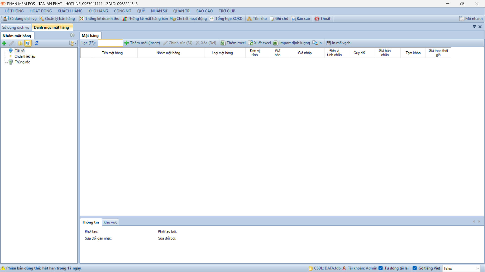 | Màn Danh mục mặt hàng khi chưa có dữ liệu (cây nhóm, thanh nút, cột lưới thật) |
| 02 | 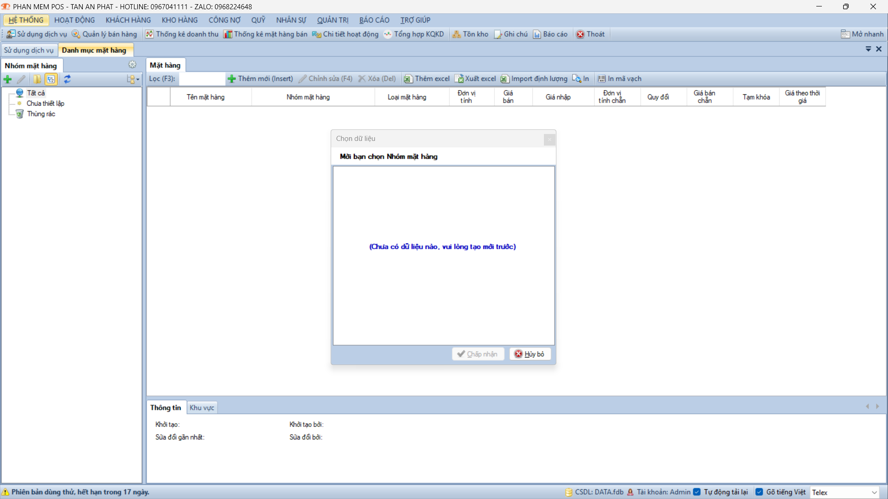 | Hộp "Chọn dữ liệu — Mời bạn chọn Nhóm mặt hàng" khi bấm Thêm mới lúc chưa chọn nhóm |
| 03 | 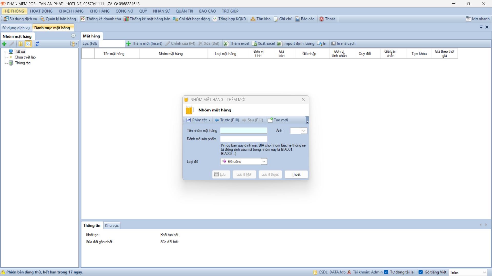 | Dialog "NHÓM MẶT HÀNG - THÊM MỚI" |
| 04 | 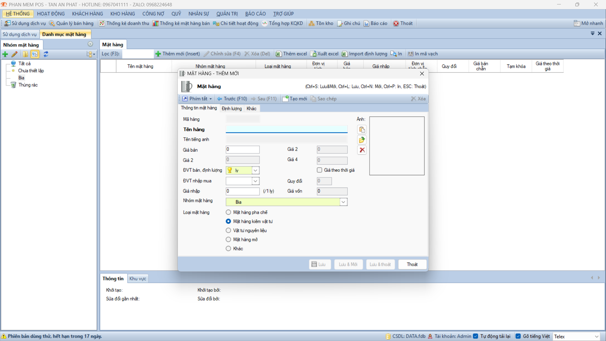 | Dialog "MẶT HÀNG - THÊM MỚI" (tab Thông tin mặt hàng) |
| 05 | 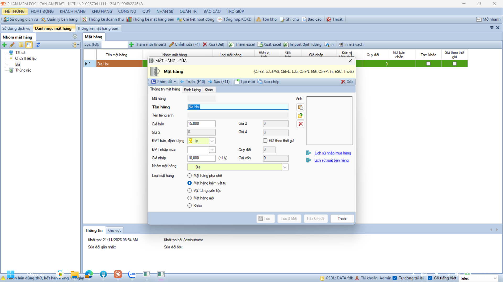 | Dialog "MẶT HÀNG - SỬA" (dải đầu vàng nhạt, hai link lịch sử) |
| 06 | 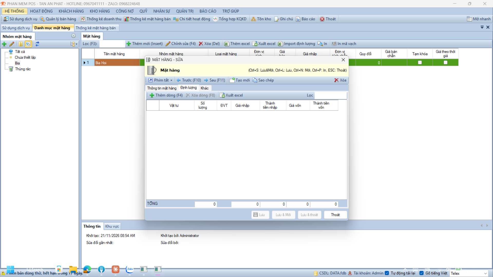 | Tab Định lượng (thanh nút phụ, cột, dòng TỔNG) |
| 07 | 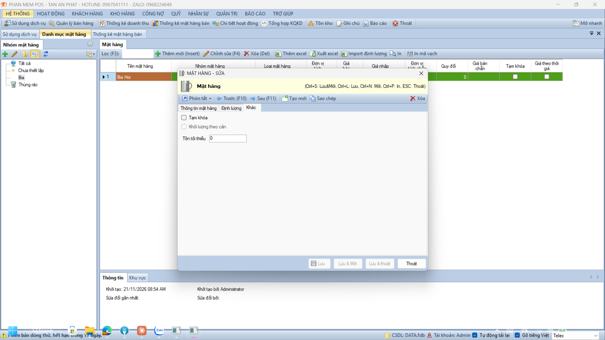 | Tab Khác (Khối lượng theo cân bị mờ) |
| 08 | 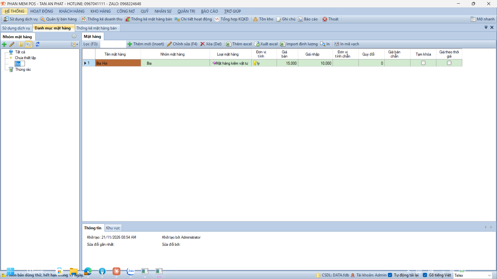 | Lưới có dữ liệu + ô Thông tin phía dưới |
| 09 | 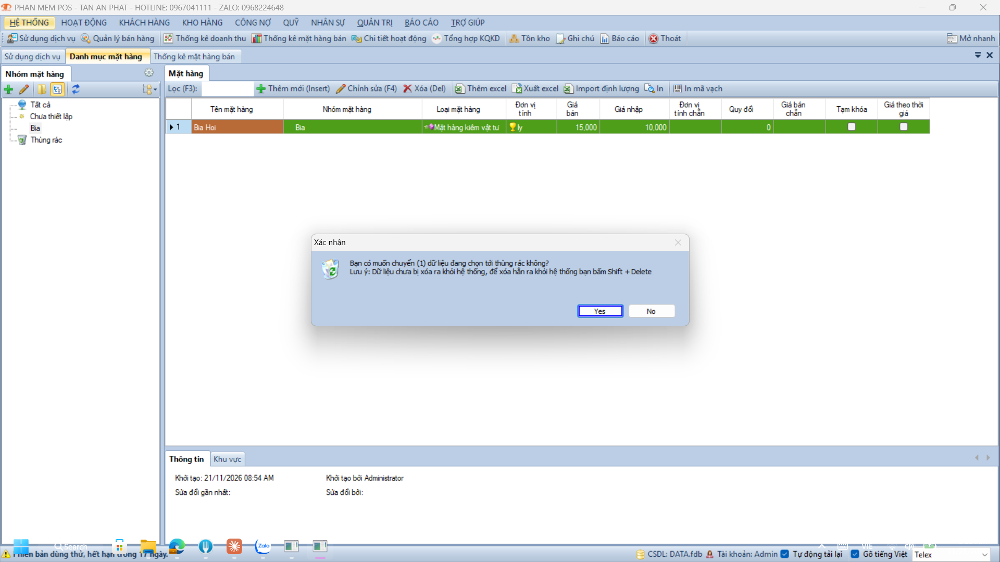 | Hộp xác nhận xóa vào thùng rác (app gốc; **bỏ** ở bản mới) |
| 10 | 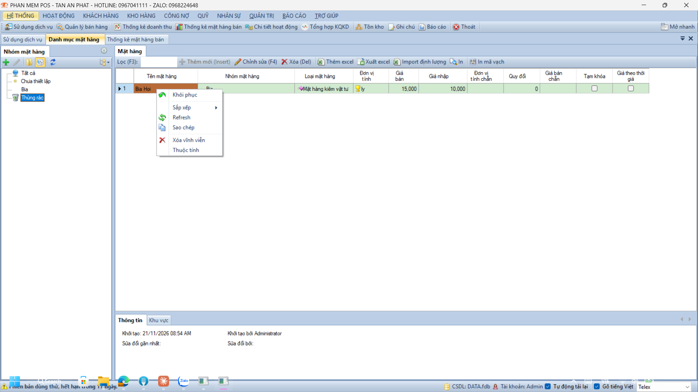 | Menu chuột phải của dòng trong Thùng rác (app gốc; **bỏ** ở bản mới) |
| 11 | 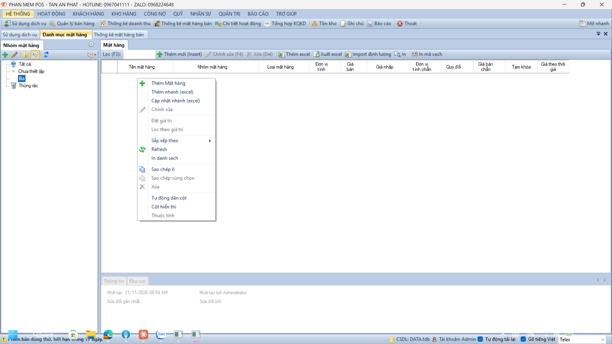 | Menu chuột phải của lưới |
| 12 | 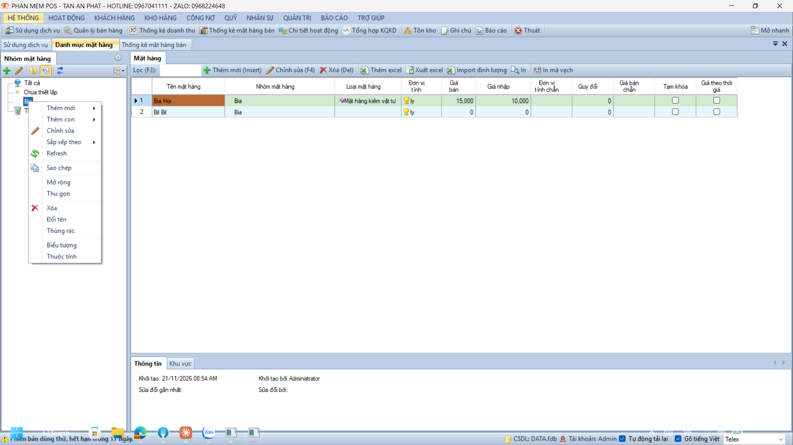 | Menu chuột phải của nhóm trên cây |
| 13 | 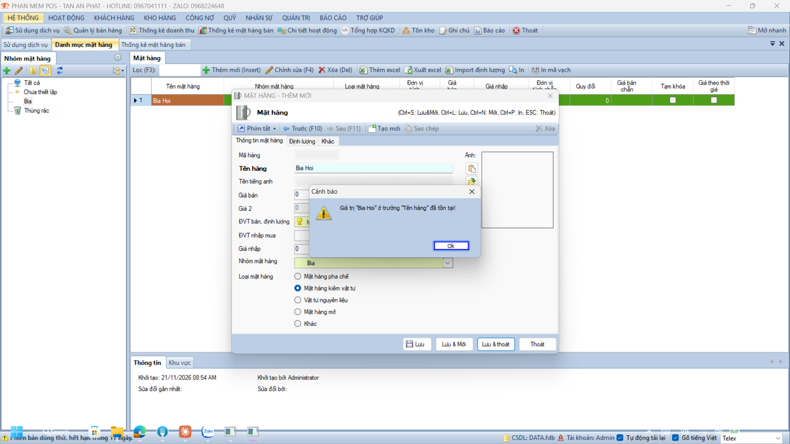 | Cảnh báo trùng tên |
| 14 | 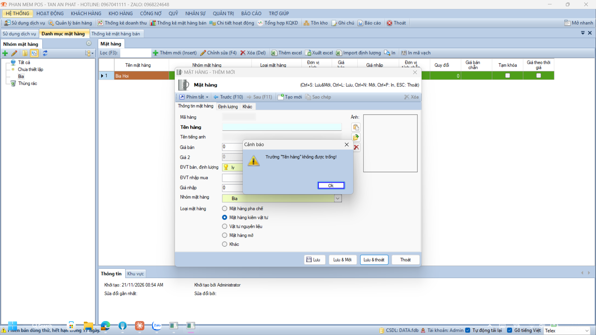 | Cảnh báo tên trống |
| 15 | 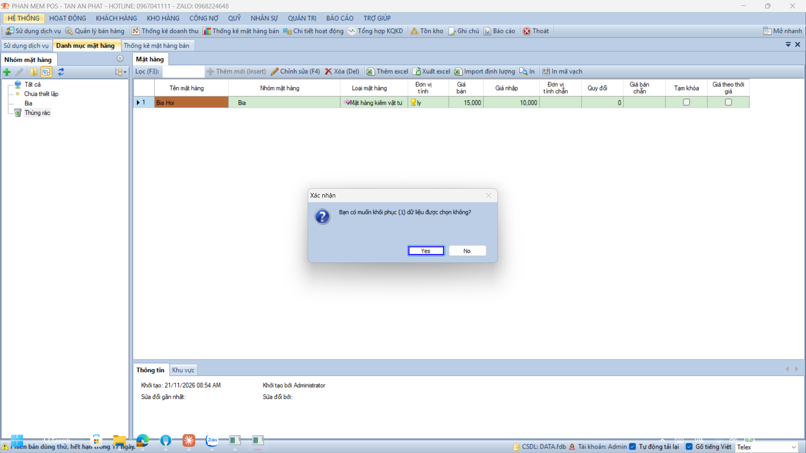 | Hộp xác nhận khôi phục (app gốc; **bỏ** ở bản mới) |
