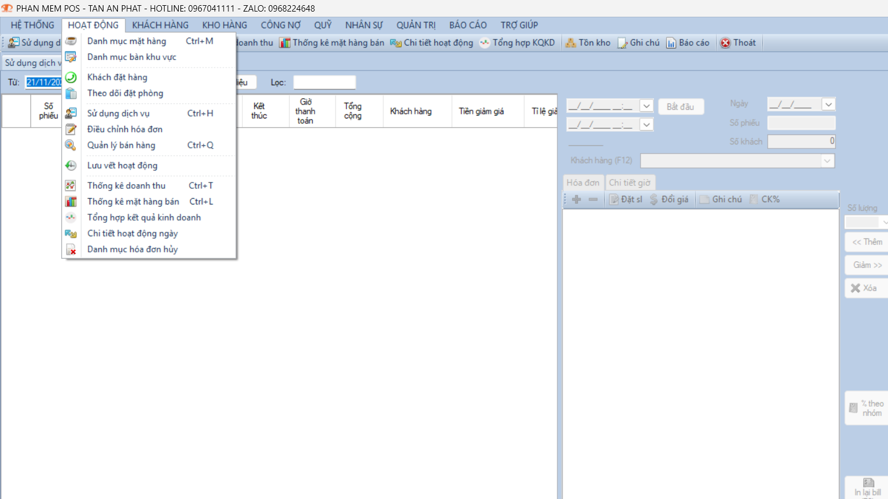
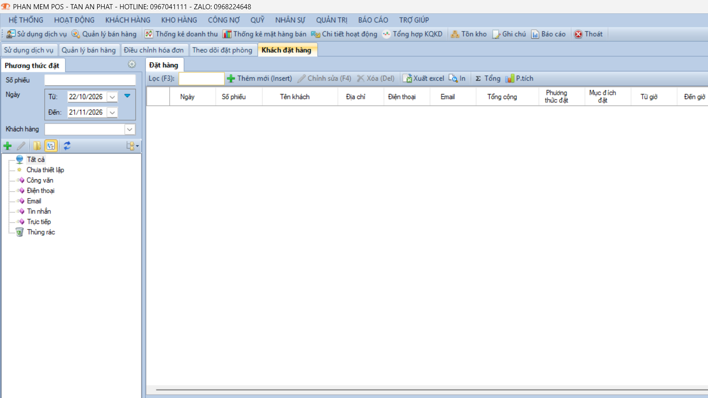
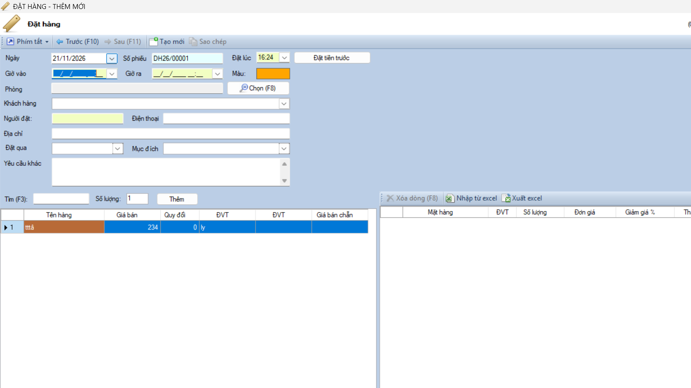
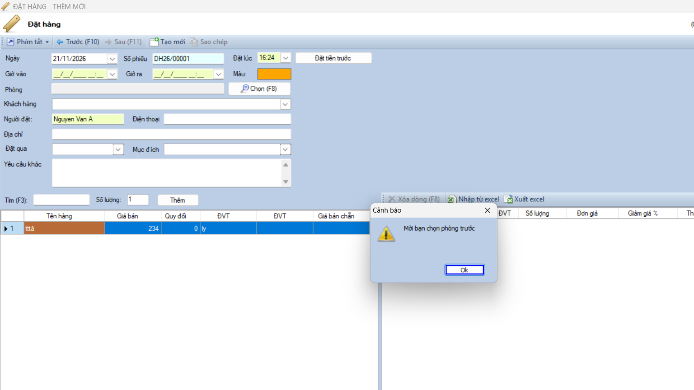
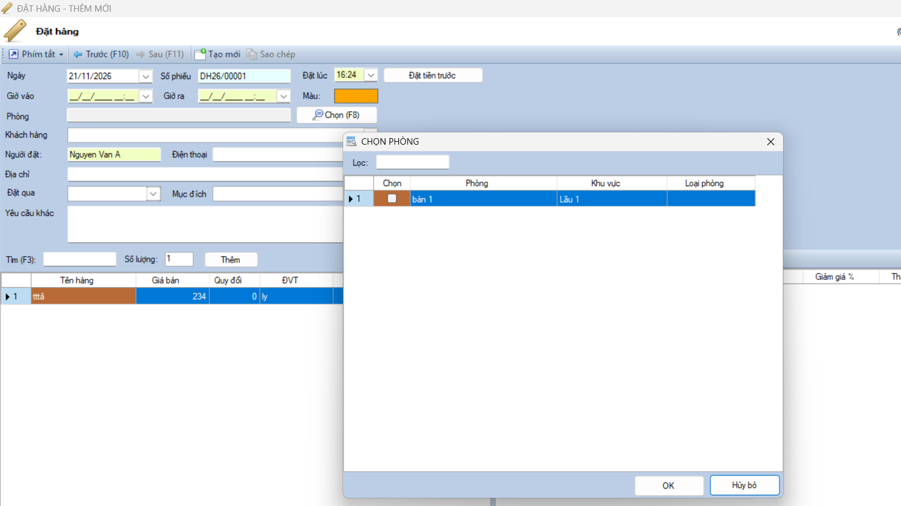

# Spec (delta): Khách đặt hàng (TDATHANG)

- Trạng thái: **NHÁP — chờ Chiến duyệt** (chưa code)
- Ngày: 2026-11-21. Base: `main` @ `6a87224` (đã `git fetch origin main`, working tree sạch)
- Khuôn: [`danh-muc-mat-hang.md`](danh-muc-mat-hang.md) (6 phần + §7 nghiệm thu + §8 gợi ý implement). Spec này **chỉ ghi phần khác khuôn**; chỗ nào không nói = **như khuôn**.
- Menu: **HOẠT ĐỘNG > Khách đặt hàng** (`SMENU` `3d3bb426-91f5-449a-8e84-1c3ca42cdb06`, `SORTORDER = ZZZ010`, `OPERATION = 0`, **không phím tắt**, `SMENU.SFUNCTIONID = NULL`). Nhóm [Khách đặt hàng, Theo dõi đặt phòng] cùng cha `a7424f09…` (HOẠT ĐỘNG); "Theo dõi đặt phòng" (`ZZZ011`, `SFORM` `11f4bf28…`) là chức năng riêng, **ngoài phạm vi** spec này.
- Bảng chính `TDATHANG` (`STABLEDESC` `780a9daf-b2b7-417c-8ff3-21700fab6990`, tên mô tả "Đặt hàng"), chi tiết `TDATHANGCHITIET` (`STABLEDESC.TABLETYPE = 4`). `TABLETYPE = 3` (màn danh sách chứng từ, giống `TDONHANG`, `TTHUCHI`), `READONLY = 0`, `GENNO = 30`, `NOTEMPLATE = DH(yy)/(*****)`, `INVOICEPRINT = 30`, `AUTOREPORT = 30`, `SFUNCTIONID` = `97487cfa-66f6-415e-9046-9a245c61f2ae` ("Đặt hàng").

## 0. Nguồn, cách đọc, giới hạn

- **[DB]** đo trên **bản chép** `POS TAP\Database\DATA.fdb` (không dùng `DEMO.FDB`; không mở file gốc). Chắc chắn.
- **[CODE]** đọc từ `POS_TAP_SRC_EXPORT/STABLEDESC/TDATHANG__780a9daf/` (`code.cs` = lớp `TDATHANGAe`, `layout.xml`), `SFORM/Hóa đơn nhà hàng__f3f7bb77`, `Hóa đơn bán hàng__5f029a5b`, `Theo dõi đặt phòng__11f4bf28`, `Tìm kiếm đặt trước__9b5b059b`. Chắc chắn.
- **[APP]** quan sát trực tiếp app gốc ngày 21/11/2026: chạy **bản sao** thư mục `POS TAP` (bỏ Backup) trong thư mục tạm, `__COMPAT_LAYER=RunAsInvoker`, tài khoản Admin, DB là bản chép; thao tác bằng script PowerShell (chụp màn hình + gửi chuột/phím). `DATA.fdb` gốc không bị đụng; đã tắt tiến trình bản sao sau khi chụp. Ảnh ở `docs/specs/img/khach-dat-hang/`.
- **[CHƯA XÁC MINH]** xếp vào §6.2 kèm kịch bản test và mặc định tạm.

**Giới hạn lần quan sát [APP]:** (1) máy chụp là màn 1536×864 (DPI ảo hóa), cửa sổ dialog đặt hàng **lớn hơn màn hình** nên ảnh 03 bị cắt mép phải/dưới — bố cục lấy từ `layout.xml` (mục 1.2); (2) script chỉ điều khiển được cửa sổ chính; **hộp "Chọn phòng" nhận được phím F8 để mở nhưng không nhận chuột/phím giả lập**, nên **chưa lưu được phiếu đặt nào**, chưa thấy dòng ghi thật xuống DB, chưa thấy menu chuột phải, hộp xác nhận xóa, thông báo trùng, màn Đặt tiền trước; (3) DB gần như trống: `TDATHANG` = 0, `TDATHANGCHITIET` = 0, `DKHACHHANG` = 0.

## 1. Bố cục UI (khác khuôn)

### 1.1 Màn danh sách "Khách đặt hàng" [APP] (ảnh 02)

Khác khuôn danh mục (cây nhóm + lưới): đây là **màn chứng từ** (`TABLETYPE = 3`), **không** có "Nhóm mặt hàng"; tab tài liệu **"Khách đặt hàng"** cạnh các tab đang mở.

- **Trái — panel lọc, tiêu đề tab "Phương thức đặt"**: ô **Số phiếu**; **Ngày Từ/Đến** (mặc định **30 ngày gần nhất**: 22/10/2026 → 21/11/2026, khớp `FILTERCONFIG` `NGAY = "30 ngày gần nhất"`); ô **Khách hàng** (lookup `DKHACHHANG`). Bên dưới là thanh nút nhỏ (thêm, sửa, 2 nút thư mục, làm mới, ▾) và **cây theo Phương thức đặt**: *Tất cả* · *Chưa thiết lập* (đơn chưa có phương thức) · các dòng `DPHUONGTHUCDAT` (Công văn, Điện thoại, Email, Tin nhắn, Trực tiếp) · ~~Thùng rác~~ (**không làm**, luật bỏ thùng rác). Bánh răng ở tiêu đề panel. Nguồn của cây (`STABLEDESC.CATEGORYCOL` = NULL nên chưa rõ cơ chế): Q4.
- **Phải — tab "Đặt hàng"** với thanh nút: ô **Lọc (F3)**, **Thêm mới (Insert)**, **Chỉnh sửa (F4)**, **Xóa (Del)**, **Xuất excel**, **In**, **Tổng**, **P.tích**. "Chỉnh sửa", "Xóa" **mờ** khi chưa chọn dòng. Excel/In/Tổng/P.tích: **có nút, v1 ở mức "chưa hỗ trợ"** (luật đã chốt).
- **Lưới** (cột thấy trên ảnh, từ trái): *(số thứ tự)* · **Ngày** · **Số phiếu** · **Tên khách** · **Địa chỉ** · **Điện thoại** · **Email** · **Tổng cộng** · **Phương thức đặt** · **Mục đích đặt** · **Từ giờ** · **Đến giờ** · (còn cột tiếp theo bị cắt: Q5). Thứ tự/độ rộng dựa `SCOLUMN` của `TDATHANG` (28 dòng, không có `SGRID` cho bảng này).
- Thanh trạng thái, phím chung: như khuôn.

### 1.2 Dialog "ĐẶT HÀNG - THÊM MỚI / SỬA"

Dialog là `TDATHANGAe` (**cùng dialog** mà "Theo dõi đặt phòng" cũng mở bằng Tạo/Sửa). **Mở tối đa hóa** (`mapper.Controller.Maximize()`, `AllowMaxWindows`); nội dung gốc `UserControl` **1020×451** [CODE], chia 2 bên trái/phải + dải dưới. Phím Enter **không** lưu (`SetSaveByEnterKey(false)`). Thanh công cụ/hàng nút Lưu như khuôn; ảnh 03: **Phím tắt ▾ · Trước (F10) · Sau (F11) · Tạo mới · Sao chép (mờ)** — **bỏ nút Sao chép** (luật chốt: bỏ Sao chép như khuôn 5.14). Dải đầu "Đặt hàng"; **nhãn "Phòng"** (app POS, dùng chung chữ với đặt phòng).

Bảng trường (tọa độ 96 DPI trong panel trái, `layout.xml`; nhân theo `DeviceDpi / 96`):

| Control | Nhãn | Vị trí (x, y) | Kích thước | Trường DB | Ghi chú |
|---|---|---|---|---|---|
| `dtNGAY` | Ngày | 91, 7 | 118×20 | `NGAY` | Mặc định hôm nay [APP] |
| `txtNAME` | Số phiếu | 270, 7 | 127×20 | `NAME` | **Tự sinh `DH26/00001` ngay khi mở dialog thêm mới** [APP]; bắt buộc, không trùng |
| `dtGIODAT` + nhãn "Đặt lúc" | Đặt lúc | 456, 5 / 410, 9 | 60×20 | `GIODAT` | Mặc định **giờ hiện tại của DB** (`DbDateTime`) |
| `btnDatTruoc` | **Đặt tiền trước** | 522, 4 | 138×23 | — | Mục 3.5 |
| `lblSoPhieuThu`, `lblSoTienDat`, `lblSoHoaDon` | Số phiếu thu / Số tiền đặt / Số hóa đơn | 522, 34 / 57 / 82 | | — | Chỉ hiện khi **đang sửa**; Phiếu thu + Số tiền ẩn nếu chưa có phiếu thu; "Số hóa đơn: " = `TDONHANG.NAME` của đơn trỏ tới phiếu này |
| `dtTUGIO` / `dtDENGIO` | **Giờ vào / Giờ ra** | 92, 34 / 270, 34 | 117×20 / 127×20 | `TUGIO` / `DENGIO` | **Hiện khi `UngDung` ≠ HOTEL** (POS TAP: hiện) [CODE] |
| `dtTUNGAY` / `dtDENNGAY` | Từ ngày / Đến ngày | 91, 34 / 270, 34 | 95×20 | `TUNGAY` / `DENNGAY` | **Hiện chỉ khi HOTEL** — POS TAP: ẩn, nhưng vẫn được **tính và ghi** (3.2) |
| `clMau` + nhãn "Màu:" | Màu | 456, 34 | 60×20 | `MAUSAC` | Mặc định **cam** (`Color.Orange`), lưu `ToArgb()` |
| `txtBan` + `btnChon` | **Phòng** / **Chọn (F8)** | 91, 60 / 403, 57 | 306×20 / 113×26 | `DBANID` (+ phiếu cùng đoàn) | `txtBan` chỉ đọc, liệt kê tên bàn đã chọn, cách nhau ", " |
| `lueDKHACHHANGID` | Khách hàng | 92, 87 | 424×21 | `DKHACHHANGID` | Lookup có "Thêm / Tải / Danh mục" ở chân danh sách [APP] |
| `txtTENKHACH` | **Người đặt:** | 92, 114 | 128×20 | `TENKHACH` | **Bắt buộc** (`SCOLUMN`; nền vàng nhạt) |
| `txtDIENTHOAI` | Điện thoại | 290, 114 | 226×20 | `DIENTHOAI` | |
| `txtDIACHI` | Địa chỉ | 92, 141 | 424×20 | `DIACHI` | |
| `lueDPHUONGTHUCDATID` | Đặt qua | 92, 167 | 128×21 | `DPHUONGTHUCDATID` | Lookup `DPHUONGTHUCDAT` |
| `lueDMUCDICHDATID` | Mục đích | 290, 167 | 226×21 | `DMUCDICHDATID` | Lookup `DMUCDICHDAT` |
| `txtNOTE` | **Yêu cầu khác** | 92, 194 | 424×51 | `NOTE` | Nhiều dòng |

Panel **phải** (`KryptonGroupBox` 301×249, dock phải): `numTIENHANG` (129, 6, 163×26) **Tiền hàng**; `numTILEGIAMGIA` (129, 38, 42×26) + `numTIENGIAMGIA` (204, 38, 88×26) **Giảm giá** (% / tiền); `numTILETHUE` (129, 70) + `numTIENTHUE` (204, 70) **Thuế** (bật theo `CoThueSuat`: hiện = 0 → mờ); `numPHIVANCHUYEN` (129, 102) **Phí vận chuyển** (bật theo `CoPhiVanChuyen`: hiện = 0 → mờ); `numTONGCONG` (129, 134) **Tổng cộng**. Số hiển thị `n0`.

Dải **dưới**, chia đôi (`KryptonSplitContainer`): **trái** = lưới tìm mặt hàng `grMatHang` (445×167; cột *Tên hàng · Giá bán · Quy đổi · ĐVT · ĐVT chẵn(?) · Giá bán chẵn* [APP]) với ô **Tìm (F3)**, **Số lượng** (mặc định 1), nút **Thêm** (Enter ở ô Số lượng = Thêm); **phải** = lưới chi tiết `detail` (570×197): cột *Mặt hàng · ĐVT · Số lượng · Đơn giá · Giảm giá % · Thành tiền*, thanh nút **Xóa dòng (F8)**, **Nhập từ excel**, **Xuất excel**. Sắp xếp lưới mặt hàng theo `CODE` nếu cấu hình sắp theo mã, ngược lại theo `NAME` [CODE].

**Thông báo/hộp con quan sát [APP]:** cảnh báo `Mời bạn chọn phòng trước` (ảnh 04, nút Ok); hộp **"CHỌN PHÒNG"** (ảnh 05): ô Lọc, lưới *Chọn (ô tích) · Phòng · Khu vực · Loại phòng*, nút **OK / Hủy bỏ**.

### 1.3 Component map

Như khuôn 1.5. Thêm: `DatePicker` ngày+giờ → `DateTimePicker`; `ColorPicker` `clMau` → nút chọn màu theme-aware (không hard-code, lưu ARGB `int`); `KryptonSplitContainer` → `SplitContainer`; `DataSearch` (`grMatHang`) → `DataGridView` + ô lọc.

## 2. Flow thao tác (khác khuôn)

1. **Mở màn:** menu **HOẠT ĐỘNG > Khách đặt hàng** (không phím tắt). Cần bit **Xem 0x10** của "Đặt hàng". Cùng quyền với "Theo dõi đặt phòng".
2. **Lọc:** panel trái (Số phiếu, Ngày Từ/Đến, Khách hàng) + cây Phương thức đặt + ô Lọc F3. Mặc định 30 ngày gần nhất.
3. **Thêm** (bit **Thêm 0x40**; Insert): **không** có bước chọn nhóm như khuôn; mở thẳng dialog. `GUID` mới (`Guid.NewGuid()`), màu cam, `Đặt lúc` = giờ DB, Số phiếu tự sinh. Ba nút Lưu mờ tới khi có thay đổi [CODE: `IsChanged = false` sau khi nạp].
4. **Chọn phòng** (F8 hoặc nút Chọn): hộp CHỌN PHÒNG, tick một hay nhiều bàn → OK → `txtBan` liệt kê. Nhiều bàn = **đặt theo đoàn** (3.1).
5. **Thêm mặt hàng:** chọn ở lưới trái + **Thêm**: số lượng lẻ = 0 và không dùng 2 ĐVT → cảnh báo `Mời bạn nhập số lượng` và không thêm; cấu hình `SuDung2DonViTinh = 30` và mặt hàng có 2 ĐVT → mở hộp "Nhập số lượng" (lẻ + chẵn). Đơn giá = `GIABAN`, hoặc theo **loại giá của khách** khi `SuDungGiaTheoKhach = 30` (hiện = 0). Cùng mặt hàng + cùng ĐVT → **cộng dồn** số lượng. Đổi khách (khi `SuDungGiaTheoKhach = 30`) → tính lại đơn giá toàn bộ dòng.
6. **Lưu** ([CODE] 2.1) → ghi `TDATHANG` + `TDATHANGCHITIET` + các phiếu cùng đoàn (3.1) **trong một transaction** (đề xuất 5.1). Lưu / Lưu & Mới / Lưu & thoát như khuôn.
7. **Sửa** (bit **Sửa 0x20**; F4 hoặc nhấp đôi): "ĐẶT HÀNG - SỬA"; nạp danh sách bàn **cùng `GUID`**; hiện số phiếu thu, số tiền đặt, số hóa đơn (nếu có).
8. **Xóa** (bit **Xóa 0x80**): **xóa hẳn** (luật bỏ thùng rác); xóa **cả đoàn** (mọi phiếu cùng `GUID`) và `TDATHANGCHITIET` của chúng; chặn theo 3.4.
9. **Đặt tiền trước / chuyển thành hóa đơn:** 3.5 và 3.6.

### 2.1 Kiểm tra khi lưu — `mapper_BeforeSave` [CODE], theo thứ tự

| # | Điều kiện | Thông báo (nguyên văn) | Hủy lưu |
|---|---|---|---|
| 1 | Chưa chọn bàn nào (`dicBan` rỗng) | `Mời bạn chọn phòng trước` [APP ảnh 04] | Có |
| 2 | Bàn hiện tại của phiếu không còn trong danh sách đã chọn | (im lặng) gán `DBANID` = bàn đầu tiên trong danh sách | — |
| 3 | Dialog đang hiện Giờ vào (POS) | (im lặng) `TUNGAY` = ngày của `TUGIO` lúc 00:00 | — |
| 4 | Dialog đang hiện Giờ ra (POS) | (im lặng) `DENNGAY` = ngày của `DENGIO` lúc 00:00 | — |
| 5 | `DENNGAY < TUNGAY` | `Từ ngày/giờ phải sau Đến ngày/giờ` (câu chữ gốc, nghĩa đảo) | Có |

Ngoài `BeforeSave` (framework theo `SCOLUMN`; nguyên văn của framework như khuôn 2.2): bắt buộc **Số phiếu** (`ALLOWEMPTY=NO`, `ALLOWDUPLICATE=NO`), **Tên khách** (`TENKHACH`), **Từ giờ** (`TUGIO`), **Đến giờ** (`DENGIO`), **Từ ngày** (`TUNGAY`), **Đến ngày** (`DENNGAY`), **Giờ đặt** (`GIODAT`) (`ALLOWEMPTY = NO`). Lưu ý: **POS TAP ẩn Từ/Đến ngày nhưng chúng bắt buộc** — được `BeforeSave` điền tự động từ Giờ vào/Giờ ra, nên ở POS **Giờ vào + Giờ ra thực tế bắt buộc**; nếu để trống thì `TUNGAY/DENNGAY` không điền được và framework có thể chặn: Q2.

## 3. Luật nghiệp vụ (khác khuôn)

### 3.1 Chứng từ đoàn — một đơn đặt nhiều bàn [CODE `mapper_AfterSave`]

Đơn đặt là **chứng từ (header `TDATHANG` + dòng `TDATHANGCHITIET`)**, không phải danh mục. **Mỗi bàn một dòng `TDATHANG`**; các dòng của cùng một đoàn dùng chung `GUID`. Sau khi lưu phiếu đang sửa:

1. Đọc mọi dòng `TDATHANG` cùng `GUID`; xóa `TDATHANGCHITIET` của các dòng **khác** dòng đang sửa.
2. Với mỗi bàn **mới** được chọn mà chưa có dòng: tái dùng dòng của **bàn bị bỏ** (đổi `DBANID`), nếu hết thì **tạo dòng mới**: `NGAY` = ngày đang chọn, `NAME` = số phiếu mới `DbUtils.GenSoHoaDon(NGAY, "DH(yy)/(*****)", TDATHANG, NAME, NGAY)`, `GUID` chung.
3. Dòng của bàn bị bỏ mà không tái dùng được → **xóa** (`DELETE FROM TDATHANG`).
4. Chép thông tin chung (`NGAY, TUNGAY, DENNGAY, TUGIO, DENGIO, GIODAT, MAUSAC, TENKHACH, DIENTHOAI, DIACHI, DKHACHHANGID, NOTE, TIENHANG, TILEGIAMGIA, TIENGIAMGIA, TILETHUE, TIENTHUE, PHIVANCHUYEN, TONGCONG`) sang các dòng còn lại; chép lại **toàn bộ chi tiết** (`DDONVITINHID, DMATHANGID, DONGIA, NOTE, SOLUONG, THANHTIEN, TILEGIAMGIA`) cho từng dòng.

Hệ quả: mỗi bàn trong đoàn có **số phiếu riêng** (`DH26/00001`, `DH26/00002`…) nhưng cùng khách/giờ/hàng. Màn "Khách đặt hàng" hiện **mỗi dòng `TDATHANG` một hàng** [CHƯA XÁC MINH bằng app: Q6].

### 3.2 Cột `TDATHANG` / `TDATHANGCHITIET` [DB]

`TDATHANG` (33 cột): `ID` GUID chuỗi PK; `NAME` NOT NULL (số phiếu); `NGAY`, `TUNGAY`, `DENNGAY`, `TUGIO`, `DENGIO`, `GIODAT` kiểu **TIMESTAMP**; `TENKHACH`, `DIACHI`, `DIENTHOAI`, `EMAIL`, `NOTE` VARCHAR(255); tiền **NUMERIC(18,2)**: `TIENHANG, TILETHUE, TIENTHUE, TILEGIAMGIA, TIENGIAMGIA, PHIVANCHUYEN, TONGCONG`; `LOAI`, `GIAMTHEOTIEN` (0/30: giảm theo tiền) INTEGER; `LOAIGIA` INTEGER mặc định 0, `MAUSAC` INTEGER mặc định 0 (ARGB); FK mềm: `DKHACHHANGID`, `DPHUONGTHUCDATID`, `DMUCDICHDATID`, `DBANID`; `GUID` (đoàn); lưu vết `STATUS` (NOT NULL), `USERCREATEDID` (NOT NULL), `TIMECREATED`, `USERMODIFIEDID`, `TIMEMODIFIED`. **Không có cột trạng thái đơn, không có cột tiền cọc, không có cột cửa hàng.** `TDATHANGCHITIET`: `ID, STATUS, USERCREATEDID` NOT NULL; `TDATHANGID, DMATHANGID, DDONVITINHID, SOLUONG, DONGIA, THANHTIEN, TILEGIAMGIA` NUMERIC(18,2), `NOTE, BAOHANH`, lưu vết.

`EMAIL`: có cột và có trong `SCOLUMN` (hiện trên lưới) nhưng **không có ô trên dialog** — giữ nguyên giá trị cũ khi sửa. `LOAI`: `NotShow`, không code nào gán (Q9). `LOAIGIA`: `NotShow`; nút `btnLoaiGia_Click` rỗng (Q9).

### 3.3 Tính tiền [CODE `mapper_OnCalculation`]

- `TIENHANG` = tổng `THANHTIEN` các dòng chi tiết.
- Nếu `GIAMTHEOTIEN = 30` (người dùng gõ vào ô **Tiền giảm giá**): `TILEGIAMGIA = TIENGIAMGIA * 100 / TIENHANG` (0 nếu `TIENHANG = 0`).
- Ngược lại (gõ **% giảm**): `TIENGIAMGIA = 100 * Round(TIENHANG * TILEGIAMGIA / 10000)` — **làm tròn về bội 100 bằng `Math.Round` (banker's, mặc định .NET)** [CODE]. *Khác* luật chốt "LamTron bội 1000 AwayFromZero": ghi ở §5.3.
- `TIENTHUE = TILETHUE * (TIENHANG - TIENGIAMGIA) / 100`.
- `TONGCONG = TIENHANG - TIENGIAMGIA + TIENTHUE + PHIVANCHUYEN`.
- Gõ vào ô % → `GIAMTHEOTIEN = 0`; gõ vào ô tiền → `GIAMTHEOTIEN = 30` (chỉ khi ô đang có focus).
- Dòng chi tiết: công thức `THANHTIEN` do `GridMapper` (framework): **chưa đọc được** — Q7. Mặc định tạm: `THANHTIEN = SOLUONG * DONGIA * (1 - TILEGIAMGIA/100)`.

### 3.4 Trạng thái và xóa

**Không có trường trạng thái.** "Đã chuyển thành hóa đơn" **suy ra từ `EXISTS (SELECT * FROM TDONHANG WHERE TDATHANGID = TDATHANG.ID)`** [CODE: `Tìm kiếm đặt trước`, `Hóa đơn bán hàng`]; "đã đặt cọc" từ `TTHUCHI.TDATHANGID`. Không có "Hủy đơn" như trạng thái — **hủy = xóa** (hoặc, nếu hóa đơn tạo ra bị xóa hết hàng, liên kết được gỡ: 3.6).

**Xóa chặn khi còn tham chiếu:** `STABLEDESC.REFCONFIG` của `TDATHANG` trỏ tới `TDONHANG`, `TLUUTAM`, `TTHUCHI`; ba bảng này đều có cột `TDATHANGID` [DB]. Ở form "Theo dõi đặt phòng" [CODE]: nếu **bất kỳ dòng nào trong đoàn** có tham chiếu → cảnh báo `Bạn không thể xóa đặt phòng này vì đã đặt tiền hoặc đã tạo hóa đơn`, không xóa; hộp xác nhận `Bạn có muốn thực hiện xóa đặt phòng đang chọn không?` (Yes/No) → `DELETE TDATHANG` + `DELETE TDATHANGCHITIET`. Màn "Khách đặt hàng" dùng cơ chế xóa chung của framework (câu xác nhận như khuôn 2.2 [FW]); chữ cảnh báo tham chiếu của màn này: Q8. **Mặc định tạm:** xóa cả đoàn, kiểm 3 bảng `TDONHANG`, `TLUUTAM`, `TTHUCHI` theo `TDATHANGID`, chữ cảnh báo thay "đặt phòng" thành "đặt hàng".

### 3.5 Đặt tiền trước (cọc) [CODE `btnDatTruoc_Click`]

- Nút **Đặt tiền trước** trước hết **lưu phiếu** (`DoSave(SAVE)`; thất bại → dừng), rồi mở dialog **Phiếu thu** (`TTHUCHI`, cùng dialog đã làm ở pilot `pilot-phieu-thu.md`).
- Tìm phiếu thu cũ `SELECT ID FROM TTHUCHI WHERE TDATHANGID = <ID phiếu đặt>`; có → nạp lại để sửa. Chưa có → điền sẵn: `TDATHANGID` = ID phiếu đặt, `TENDOITUONG` = Người đặt, `DIACHI`, `DKHACHHANGID`, **`THU` = `TONGCONG`**, `DLYDOTHUCHIID` = lý do của phiếu thu đặt trước gần nhất (`ORDER BY TIMECREATED DESC`), `DIENGIAI` = `"Đặt tiền trước số phiếu đặt hàng: " + Số phiếu`.
- **Cọc không lưu trong `TDATHANG`** mà là **một phiếu thu `TTHUCHI` gắn `TDATHANGID`** (tối đa một/đơn theo cách code truy vấn; không có ràng buộc DB). Hiển thị lại: `Số phiếu thu: <TTHUCHI.NAME>` và `Số tiền: <THU, n0>` (nhãn trên dialog ghi "Số tiền đặt").
- Khi thanh toán hóa đơn sinh từ đơn đặt: `datTruoc = TTHUCHI.THU` của phiếu đặt (`Hóa đơn bán hàng`: `GetDatTruoc()`; mẫu in hóa đơn nhận tham số `DatTruoc` qua `mapper_CustomDictionaryForInvoice`).
- Phiếu thu cọc **không** tính vào công nợ khách: truy vấn công nợ loại `TDATHANGID IS NULL` [CODE `Hóa đơn bán hàng` dòng 733].

### 3.6 Giữ bàn và chuyển thành hóa đơn

- **Giữ bàn:** chỉ là `TDATHANG.DBANID` + ngày. **Không ghi vào `DBAN`** (không cột trạng thái). Ở màn bán hàng, bàn được tô "đã đặt" bằng truy vấn `EXISTS (SELECT * FROM TDATHANG WHERE DBANID = DBAN.ID AND TUNGAY = CURRENT_DATE)` [CODE `Dịch vụ máy tính bảng` dòng 3401]. Không có kiểm tra "trùng lịch" khi lưu đơn đặt.
- **Chuyển thành hóa đơn (nhà hàng/quầy bàn)** [CODE `Hóa đơn nhà hàng`]: ở màn **Sử dụng dịch vụ**, chọn bàn → `MoBanTuDatPhong` mở form **"Tìm kiếm đặt trước"** (lọc `NGAY BETWEEN Đặt từ/đến`, `TUNGAY|DENNGAY BETWEEN Đến từ/đến` mặc định hôm nay, **và `NOT EXISTS (TDONHANG WHERE TDATHANGID = TDATHANG.ID)`** — chỉ đơn chưa có hóa đơn); chọn một đơn → `TaoMoiHoaDon(dhRow)`: bàn đang có khách → cảnh báo `{phòng/bàn} này đang có khách`; ngược lại tạo `TDONHANG` trắng (`TaoHoaDonTrang`) với **`TDONHANG.TDATHANGID` = ID phiếu đặt** và `DKHACHHANGID` = khách của đơn, rồi nạp mặt hàng từ `TDATHANGCHITIET` vào hóa đơn (**giá đặt nếu bàn của hóa đơn = bàn của phiếu**, ngược lại giá khu vực/giờ); không có mặt hàng thì thôi.
- **Chuyển thành hóa đơn (bán lẻ)** [CODE `Hóa đơn bán hàng` `btnMoDatHang_Click`]: nút "Mở đặt hàng" chỉ khi hóa đơn còn trống (`Mời bạn tạo mới hóa đơn trước`); chọn đơn chưa có hóa đơn → gán `TDONHANG.TDATHANGID`, khách, nạp các dòng chi tiết (quy đổi ĐVT), và **chép giảm giá của đơn đặt** (`TILEGIAMGIA`, `TIENGIAMGIA`, `GIAMTHEOTIEN`).
- **Sau khi chuyển:** `TDATHANG` **không đổi gì**. Đơn "đã chuyển" chỉ nhận biết qua `TDONHANG.TDATHANGID`. Xóa hết hàng hóa đơn (`EmptyDonHang`) → `TDONHANG.TDATHANGID = ''` ⇒ đơn đặt **hiện lại** là chưa chuyển.
- Các luồng này thuộc spec **Bán hàng**; spec này chỉ cần dữ liệu đúng (3.1–3.5) và màn "Khách đặt hàng" **không có nút tạo hóa đơn** [APP ảnh 02: thanh nút không có].

### 3.7 Mẫu in

`STABLEDESC.INVOICEPRINT = 30`, `AUTOREPORT = 30` và `INVOICEPARAM` có dữ liệu; mẫu in phiếu đặt (`SREPORT`/`SREPORTTEMPLATE`) và nút "In" của màn: **v1 chưa hỗ trợ** (luật chốt). Tên mẫu: Q10.

### 3.8 Cấu hình `SCONFIG` liên quan (giá trị hiện hành [DB])

| Khóa | Hiện | Ảnh hưởng |
|---|---|---|
| `UngDung` (`TEXTVALUE`) | `1` (POS) | `≠ HOTEL` → hiện Giờ vào/Giờ ra, ẩn Từ/Đến ngày |
| `SuDung2DonViTinh` | 30 | Nhập số lượng lẻ + chẵn khi thêm hàng |
| `NhapMotMatHangNhieuLanTrongPhieu` | 0 | = 0: thêm trùng hàng+ĐVT thì cộng dồn |
| `SuDungGiaTheoKhach` | 0 | Giá theo `DKHACHHANG.GIABAN` (0..3 → Giá 1..4) |
| `CoThueSuat` / `CoPhiVanChuyen` | 0 / 0 | Ô thuế / phí vận chuyển mờ |
| `SuDungMaHang`, `SuDungMaSanCo` | 0 | Cột/mã trên lưới chọn hàng và import excel |
| `LamTronTien` | 1000 | **Không** được code đặt hàng dùng (3.3) |
| Số phiếu | — | Mẫu `DH(yy)/(*****)` nằm ở `STABLEDESC.NOTEMPLATE`, **không** ở `SCONFIG` |

Không có khóa `SCONFIG` riêng cho "tiền cọc/đặt bàn/đặt hàng" (đã tìm theo `%Coc%`, `%DatTruoc%`, `%DatBan%`, `%DatPhong%`).

## 4. Phân quyền

Chức năng **"Đặt hàng"** (`SFUNCTION` `97487cfa-66f6-415e-9046-9a245c61f2ae`; **dùng chung với "Theo dõi đặt phòng"** — màn đó có `SMENU.SFUNCTIONID` trỏ cùng ID). Cờ `MODE`: Xem 0x10, Sửa 0x20, Thêm 0x40, Xóa 0x80. `SGROUPROLE` [DB]:

| Nhóm | `MODE` | Ý nghĩa |
|---|---|---|
| Quản lý | 240 | Xem + Sửa + Thêm + Xóa |
| Kế toán | 240 | đủ |
| Thu ngân | **80 (0x50)** | **Xem + Thêm** (không Sửa/Xóa) |
| Phục vụ | 0 | Khóa |
| Thủ kho | không có dòng | Khóa |

Admin đủ quyền. Nút "Đặt tiền trước" mở phiếu thu: quyền của "Phiếu thu" xét riêng (spec Quỹ). Còn lại như khuôn mục 4 (mặc định tạm: nút thiếu quyền **mờ**).

## 5. Chỗ khác app gốc (đề xuất — CHỈ ghi, KHÔNG tự quyết, Chiến quyết)

1. **Transaction.** Lưu `TDATHANG` đoàn + chi tiết + sinh số phiếu các dòng phụ = **một transaction** (app gốc ghi từng câu lệnh rời, đoạn `AfterSave` xóa/tạo/chép nhiều bước dễ để dở dang).
2. **SQL tham số hóa** mọi truy vấn (`'` + GUID + `'` trong code gốc).
3. **Làm tròn giảm giá.** App gốc làm tròn `TIENGIAMGIA` bằng `Math.Round` về bội 100; luật chốt là `LamTron` bội 1000 AwayFromZero *chỉ khi tính tiền*. Chờ Chiến quyết đặt hàng theo luật nào (mặc định tạm: giữ **bội 100 như app gốc** để số trùng app gốc, ghi vào Q1).
4. **Câu `Từ ngày/giờ phải sau Đến ngày/giờ`** nghĩa đảo (báo khi *Đến < Từ*) và so **chỉ phần ngày** nên không bắt được Giờ ra < Giờ vào cùng ngày. Đề xuất: so cả ngày+giờ và sửa câu thành `Giờ ra phải sau giờ vào`. Chờ Chiến quyết (giữ nguyên chữ hay sửa).
5. **Bug nghi vấn `dtTUGIO_OnEditValueChanged`:** sửa Giờ vào lại gán `dtDENNGAY` (đúng ra `dtTUNGAY`); với POS không ảnh hưởng vì `BeforeSave` ghi đè. Không bắt chước.
6. **Đặt theo đoàn nhiều bàn.** Ba tính năng gắn với "Theo dõi đặt phòng" (đặt theo đoàn nhiều phòng, ô màu, Giờ vào/ra theo ca) có thể nằm ngoài nhu cầu "đặt hàng" thuần. Đề xuất vẫn **giữ y hệt dialog** (một dialog cho cả hai màn) nhưng nếu Chiến muốn đơn giản hóa: bỏ chọn nhiều bàn. Chờ Chiến.
7. **Hai chữ "Phòng"/"Bàn".** Nhãn "Phòng" lấy theo `Shared.GetTenPhongBan`; bản mới đọc cùng cấu hình thay vì hard-code.
8. **Thùng rác** (có trong cây ảnh 02): **bỏ** (luật chốt).
9. **Bảng giá theo giờ** (`CoTienGio = 0`, tính giờ): không dựng phần "giá theo giờ" khi nạp mặt hàng vào hóa đơn (thuộc spec Bán hàng).

## 6. Câu hỏi

### 6.1 Đã trả lời bằng app gốc (21/11/2026) [APP]

| # | Câu hỏi | Kết quả |
|---|---|---|
| A1 | Menu có phím tắt? Vị trí? | HOẠT ĐỘNG, dòng thứ 3 (sau "Danh mục bàn khu vực", trước "Theo dõi đặt phòng"); **không phím tắt** (ảnh 01) |
| A2 | Màn danh sách có cây nhóm? | Có nhưng là **cây "Phương thức đặt"** (Tất cả / Chưa thiết lập / 5 phương thức / Thùng rác) + panel lọc Số phiếu / Ngày / Khách hàng (ảnh 02) |
| A3 | Số phiếu sinh khi nào? | **Ngay khi mở dialog thêm mới**: `DH26/00001` (mẫu `DH(yy)/(*****)`, 5 chữ số) (ảnh 03) |
| A4 | Lưu khi chưa chọn bàn? | `Mời bạn chọn phòng trước`, nút Ok (ảnh 04) |
| A5 | Hộp chọn phòng | Tiêu đề "CHỌN PHÒNG", lọc, cột *Chọn · Phòng · Khu vực · Loại phòng*, OK / Hủy bỏ (ảnh 05) |
| A6 | Lưu không nhập Người đặt có báo gì? | **Chưa thử được** (thông báo bàn chặn trước) |

### 6.2 Còn mở — kèm kịch bản test và "mặc định tạm"

| # | Câu hỏi | Test trên app gốc | Mặc định tạm (Muse) |
|---|---|---|---|
| Q1 | Làm tròn giảm giá theo luật nào (5.3) | Chiến quyết | Giữ `Math.Round` bội 100 như app gốc |
| Q2 | POS: để trống Giờ vào/Giờ ra có lưu được không (vì `TUNGAY/DENNGAY/TUGIO/DENGIO` bắt buộc)? Thông báo? | Thêm đơn, chọn bàn, bỏ trống Giờ vào/ra, Lưu | **Bắt buộc Giờ vào + Giờ ra** khi POS, thông báo kiểu `Trường "Giờ vào" không được trống!` ([FW], khuôn 2.2) |
| Q3 | Ghi thật xuống DB khi lưu đơn 1 bàn / nhiều bàn: giá trị từng cột (`STATUS=30`? `LOAI`? `TUNGAY` có giờ?) | Lưu đơn mẫu, đọc DB bản sao | Theo 3.1–3.2; `STATUS = 30`; `LOAI`, `GIAMTHEOTIEN` mặc định 0; `TIENHANG…TONGCONG` ghi đúng ô dialog |
| Q4 | Cây "Phương thức đặt": lọc bằng `DPHUONGTHUCDATID`; "Chưa thiết lập" = `DPHUONGTHUCDATID IS NULL OR = ''`? (`CATEGORYCOL` = NULL nên cơ chế chưa rõ) | Chọn từng nút | Lọc theo `DPHUONGTHUCDATID` đúng nút; "Chưa thiết lập" = rỗng/NULL; chọn nút cha = như "Tất cả" |
| Q5 | Cột còn lại của lưới sau "Đến giờ" (cuộn ngang), cột nào ẩn mặc định, rộng bao nhiêu | Cuộn lưới / menu "Cột hiển thị" | Dùng `SCOLUMN` theo thứ tự: bỏ cột `NotShow` (`GIAMTHEOTIEN, GUID, LOAI, LOAIGIA, MAUSAC`), thêm *Giờ đặt, Bàn, Khách hàng, Tiền hàng, Tiền giảm giá, Tỉ lệ giảm giá, Ghi chú* theo thứ tự tên cột |
| Q6 | Màn "Khách đặt hàng" liệt kê mỗi dòng `TDATHANG` (mỗi bàn) hay gộp đoàn? | Đặt đơn 2 bàn, xem lưới | **Mỗi dòng một hàng**; thêm cột **Bàn** để phân biệt |
| Q7 | `THANHTIEN` của dòng chi tiết; cột *Giảm giá %* sửa được không; có sửa `DONGIA` | Sửa số lượng/giá/giảm trên lưới phải | `SOLUONG * DONGIA * (1 - TILEGIAMGIA/100)`; sửa được Số lượng, Đơn giá, Giảm giá % |
| Q8 | Xóa trên màn Khách đặt hàng: hộp xác nhận và cảnh báo tham chiếu (nguyên văn); có chặn khi còn `TTHUCHI`/`TDONHANG` | Xóa đơn có phiếu cọc / có hóa đơn | 3.4 mặc định |
| Q9 | `LOAI`, `LOAIGIA`, `btnLoaiGia` (nút rỗng): có dùng không | Tìm trong code các form khác | Không dùng; ghi 0, giữ nguyên khi sửa |
| Q10 | Nút **In** của màn đặt hàng chọn mẫu nào (`SREPORT` nào), nút **Tổng / P.tích** là gì | Bấm từng nút | Ngoài v1: nút tồn tại, báo "chưa hỗ trợ" |
| Q11 | Menu chuột phải của lưới và của cây (có mục nào khác khuôn?) | Chuột phải | Như khuôn trừ mục Thùng rác/Sao chép |
| Q12 | Thông báo trùng số phiếu; sửa số phiếu tay được không; số phiếu chạy theo năm/tháng (`SoHoaDonQuayVongTheo = 1`)? | Thêm đơn, sửa Số phiếu trùng | Không cho trùng; sinh số theo `GenSoHoaDon` (xem khuôn spec Quỹ); sửa tay cho phép |
| Q13 | Hộp "Nhập số lượng" lẻ+chẵn khi thêm hàng có 2 ĐVT (dialog `NhapSoLuong`) | Thêm mặt hàng có ĐVT chẵn | Dựng hộp 2 ô (lẻ, chẵn) đơn giản, theo `ThemSoLuongChan` |
| Q14 | Hỏi lưu khi đóng dialog có thay đổi; F10/F11 chuyển dòng | Gõ rồi Thoát; F10/F11 | Như khuôn Q23 |

## 7. Tiêu chí nghiệm thu (rút gọn — Muse kiểm trên bản sao DB)

**Dữ liệu & luật**
- [ ] Thêm đơn 1 bàn (Số phiếu tự sinh `DH{yy}/{5 chữ số}` không trùng, Người đặt, Giờ vào/ra, ≥ 1 mặt hàng): ghi 1 dòng `TDATHANG` (`STATUS = 30`, `ID`/`GUID` GUID, `USERCREATEDID`, `TIMECREATED`, `TUNGAY/DENNGAY` = ngày của `TUGIO/DENGIO` lúc 00:00) + các dòng `TDATHANGCHITIET`; **không DDL**.
- [ ] Đơn nhiều bàn: N dòng `TDATHANG` cùng `GUID`, số phiếu khác nhau, thông tin chung và chi tiết chép giống nhau; bỏ bớt bàn khi sửa → dòng thừa bị xóa (cùng chi tiết); thêm bàn → tạo/tái dùng đúng 3.1.
- [ ] `BeforeSave`: chưa chọn bàn → `Mời bạn chọn phòng trước` (không lưu); đổi `Đến < Từ` → cảnh báo 2.1#5 (không lưu); thiếu bắt buộc → báo theo [FW].
- [ ] Tính tiền 3.3: `TIENHANG`, giảm theo % hay theo tiền (chuyển chế độ theo ô đang gõ), thuế, phí, `TONGCONG`; tiền `decimal`, ghi 2 chữ số thập phân.
- [ ] Thêm mặt hàng: số lượng 0 → `Mời bạn nhập số lượng`; trùng hàng+ĐVT → cộng dồn; `SuDungGiaTheoKhach = 30` → đơn giá theo loại giá khách (và tính lại khi đổi khách).
- [ ] Đặt tiền trước: lưu phiếu trước; chưa có phiếu thu → mở phiếu thu với `THU = TONGCONG` và `DIENGIO = "Đặt tiền trước số phiếu đặt hàng: …"`, ghi `TTHUCHI.TDATHANGID`; mở lại thấy `Số phiếu thu` + `Số tiền`.
- [ ] Xóa: xóa hẳn cả đoàn và chi tiết; **chặn** khi có `TTHUCHI`/`TDONHANG`/`TLUUTAM` tham chiếu (mặc định 3.4); không có thùng rác/khôi phục.
- [ ] Bản ghi do app gốc tạo (Q3) đọc/sửa được ở bản mới và ngược lại (không mất `EMAIL`, `LOAI`, `LOAIGIA`).
- [ ] "Đã chuyển hóa đơn" chỉ suy ra từ `TDONHANG.TDATHANGID`; màn Khách đặt hàng **không** sửa `TDONHANG` và **không** ghi `DBAN`.

**UI**
- [ ] Màn danh sách đúng bố cục 1.1 (panel lọc + cây phương thức đặt + thanh nút + lưới); mặc định lọc 30 ngày gần nhất; nút Excel/In/Tổng/P.tích có và báo "chưa hỗ trợ".
- [ ] Dialog đúng tọa độ/kích thước 1.2 (so `layout.xml`, nhân DPI), mở tối đa hóa, Enter không lưu; ba nút Lưu mờ tới khi có thay đổi; không hard-code màu (ô màu qua theme, lưu ARGB).
- [ ] POS: Giờ vào/Giờ ra hiện, Từ/Đến ngày ẩn; ô Thuế/Phí vận chuyển mờ theo cấu hình.

**Quyền**
- [ ] Quản lý/Kế toán đủ; Thu ngân (80) xem + thêm, không sửa/xóa; Phục vụ (0) và Thủ kho (không dòng): không thấy menu; Admin đủ. Quyền "Đặt hàng" dùng chung với "Theo dõi đặt phòng".

## 8. Gợi ý implement cho Muse (không bắt buộc)

Một patch theo skill `kazuko-patch`; không đổi DB. Theo mẫu pilot (danh mục mặt hàng):
- `Kazuko_FnB.Domain`: DTO `BookingRow` (`TDATHANG`), `BookingLine` (`TDATHANGCHITIET`).
- `Kazuko_FnB.Data`: `BookingRepository` — truy vấn danh sách (lọc Số phiếu/Ngày/Khách/Phương thức), đọc/ghi đoàn bằng **một transaction**, xóa đoàn + kiểm tham chiếu `TDONHANG/TLUUTAM/TTHUCHI`, đọc `TTHUCHI` theo `TDATHANGID`, sinh số phiếu `DH(yy)/(*****)` (dùng chung hàm sinh số của spec Quỹ nếu có).
- `Kazuko_FnB.Services`: `BookingRules` (kiểm tra 2.1, tính tiền 3.3, đoàn 3.1 — hàm thuần có selftest), quyền qua `FunctionPermissions` (SFUNCTION "Đặt hàng").
- `Kazuko_FnB.UI`: `BookingListView` (màn 1.1) + `BookingEditDialog` (1.2, kế thừa `ThemedDialog`, **dùng chung với "Theo dõi đặt phòng" sau này**) + hộp `PickRoomDialog`; nối vào `ScreenFactory` và menu; thêm file vào `.csproj` thủ công.
- `SelfTest`: ca cho 2.1, 3.1 (đoàn), 3.3, quyền mục 4, trên bản sao DB.
- Màn Khách đặt hàng **không** dựng bằng `SGRID`/`DynamicForm` (dialog có lưới con, tính tiền, đoàn); code tay theo số liệu 1.2.

## Phụ lục A — Ảnh chụp app gốc (21/11/2026) [APP]

Chụp trên bản sao POS TAP (DB chép, tài khoản Admin, màn 1536×864). Chỉ để đối chiếu bố cục/thông báo; style do theme của bản mới lo.

| # | Ảnh | Nội dung |
|---|---|---|
| 01 |  | Menu HOẠT ĐỘNG: vị trí "Khách đặt hàng", "Theo dõi đặt phòng", phím tắt các mục khác |
| 02 |  | Màn danh sách: panel lọc, cây Phương thức đặt, thanh nút, lưới |
| 03 |  | Dialog "ĐẶT HÀNG - THÊM MỚI" (bị cắt mép phải/dưới vì cửa sổ lớn hơn màn) |
| 04 |  | Cảnh báo `Mời bạn chọn phòng trước` |
| 05 |  | Hộp "CHỌN PHÒNG" |
