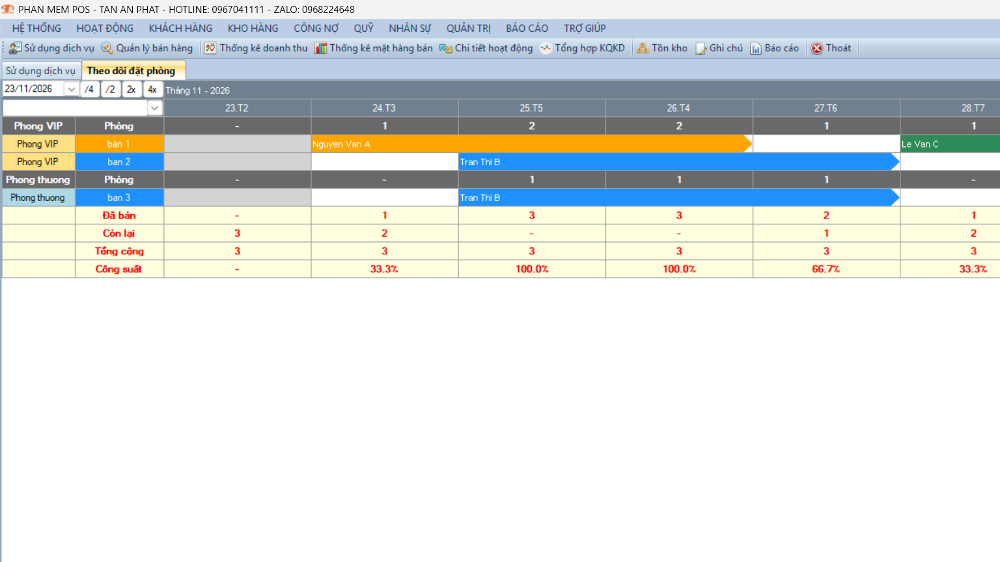
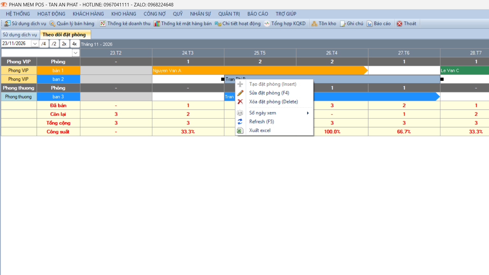
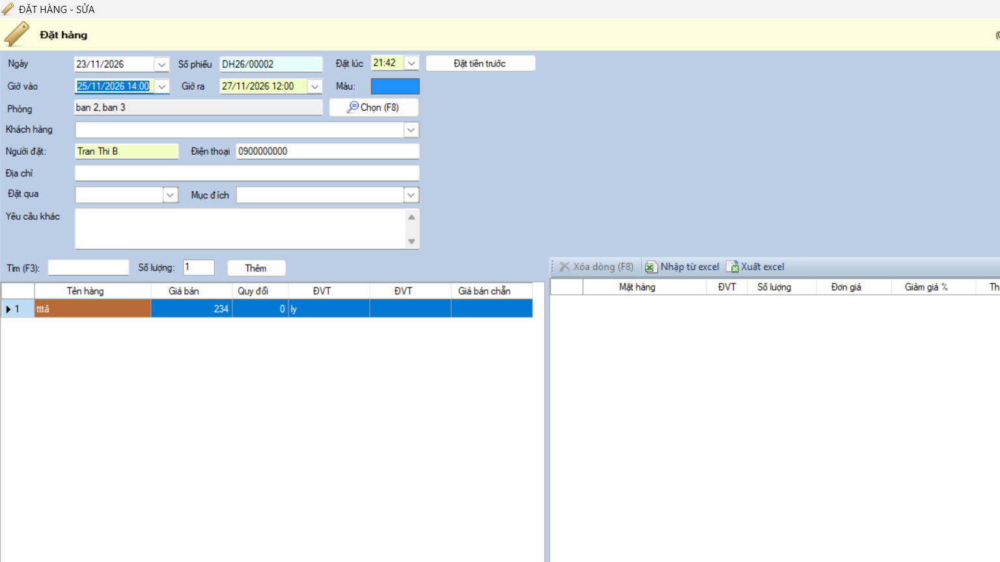
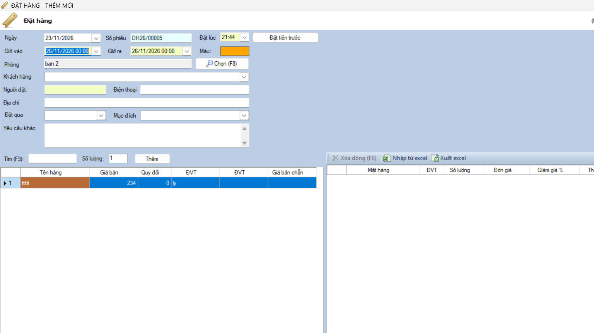
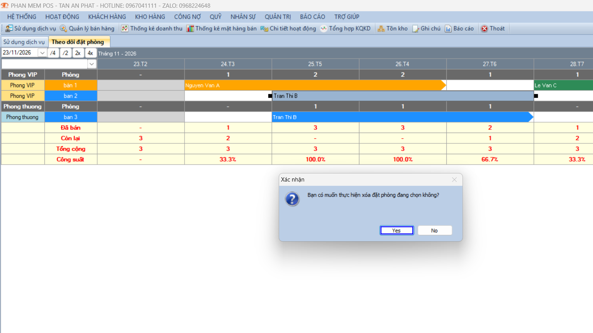
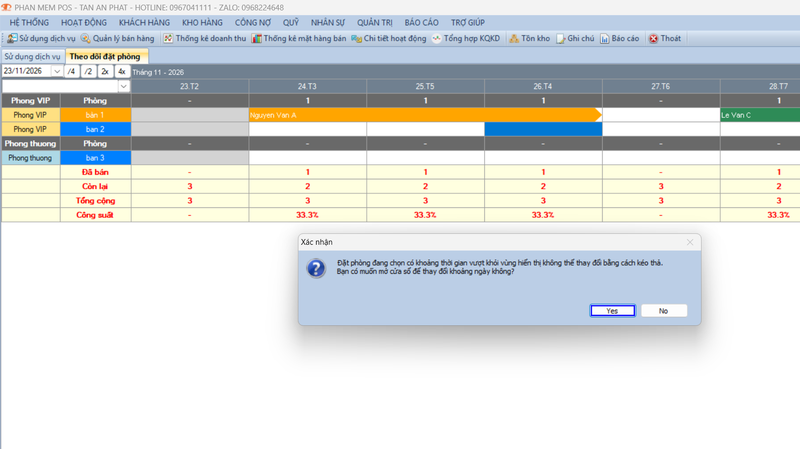
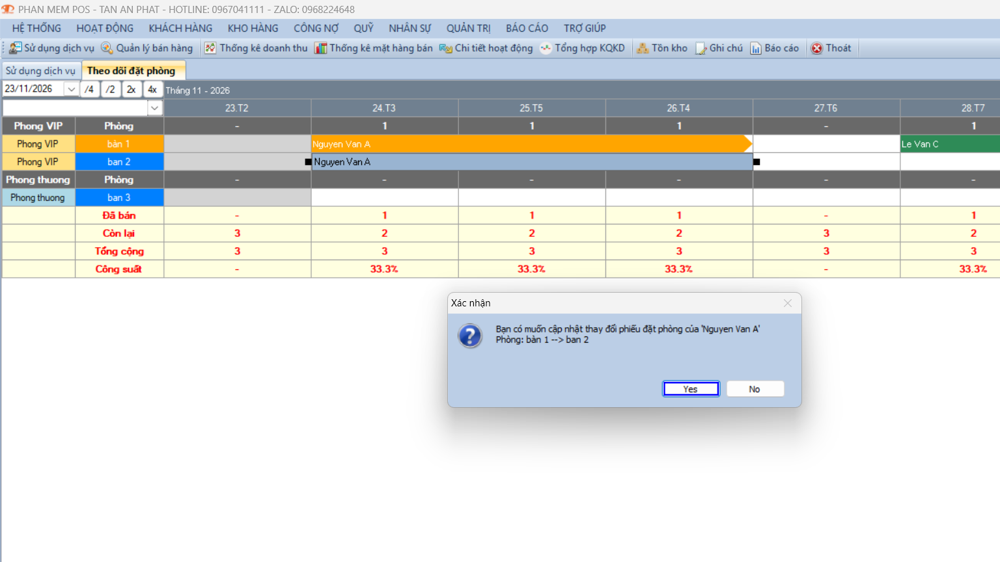

# Spec (delta): Theo dõi đặt phòng (lịch đặt bàn/phòng theo ngày)

- Trạng thái: **ĐÃ CÓ CODE trên `main`** (từ commit `ab440dd`; theo `QUEUE.md`: Q6 và 5 mục §5 đã chốt "giữ y hệt hết" ngày 23/11). Lỗi build do kiểu `internal` đã sửa ngày 25/11. Đối chiếu ngày 25/11: **chưa nghiệm thu lại từng tiêu chí** trong spec.
- Ngày: 2026-11-23. Base: `main` @ `c1a4343` (đã `git fetch origin main`)
- Khuôn: [`danh-muc-mat-hang.md`](danh-muc-mat-hang.md). Spec này chỉ ghi phần khác khuôn; chỗ nào không nói = **như khuôn**. Dữ liệu và dialog dùng chung với [`khach-dat-hang.md`](khach-dat-hang.md) (cùng bảng `TDATHANG`, cùng dialog `TDATHANGAe`): **không lặp lại** ở đây, chỉ nêu phần riêng của màn lịch.
- Menu: **HOẠT ĐỘNG > Theo dõi đặt phòng** (`SMENU` `a5142f0f-bc85-4b6e-b1da-6c4436e07a3f`, `SORTORDER = ZZZ011`, `OPERATION = 4` = mở form, `MENUCODE = TheoDoiDatPhong`, `TOOLBAR = 30`, **không phím tắt**). Form: `SFORM` **"Theo dõi đặt phòng"** `11f4bf28-9dd4-4a22-8c5c-e912a637576a` (`SFORM.STABLEDESCID = NULL`, lớp `TheoDoiDatPhong`, `No1UserControl` 681×544). `SMENU.SFUNCTIONID` = `97487cfa-66f6-415e-9046-9a245c61f2ae` ("Đặt hàng") — **cùng chức năng quyền với "Khách đặt hàng"**.
- Dữ liệu: `TDATHANG` (cùng "Khách đặt hàng"), `DBAN`, `DLOAIPHONG` (nhóm hàng cho lưới), `DMUCDICHDAT` (tooltip).

## 0. Nguồn, cách đọc, giới hạn

- **[DB]** đo trên bản chép `POS TAP\Database\DATA.fdb` (không `DEMO.FDB`).
- **[CODE]** `POS_TAP_SRC_EXPORT/SFORM/Theo dõi đặt phòng__11f4bf28/` (`code.cs` 972 dòng, `layout.xml`), `STABLEDESC/TDATHANG__780a9daf/code.cs`.
- **[APP]** quan sát app gốc 23/11/2026 trên **bản sao** `POS TAP` (bỏ Backup) trong thư mục tạm, không quyền admin, tài khoản Admin, DB chép. Thao tác bằng script PowerShell (chụp màn hình + chuột/phím). **Dữ liệu mẫu do tôi tạo trên bản sao DB** (không phải DB thật): 2 loại phòng ("Phong VIP", "Phong thuong"), 3 bàn, 4 phiếu đặt (1 đoàn 2 bàn); sau thử nghiệm đã xóa/di chuyển một số phiếu trên bản sao. `DATA.fdb` gốc không bị đụng; tiến trình bản sao đã tắt.
- **[CHƯA XÁC MINH]** → §6.2.

**Giới hạn:** màn 1536×864 nên cửa sổ dialog đặt phòng lớn hơn màn (ảnh 03/04 cắt mép phải/dưới; bố cục lấy từ `layout.xml` ở spec Khách đặt hàng); tooltip khi rê chuột lên thanh đặt, menu con "Số ngày xem" (không bung ra được qua script), kéo cạnh trái/phải để đổi ngày, màn "Đặt tiền trước": **chưa quan sát**.

**Phát hiện quan trọng:** DB thật (`DATA.fdb`) **không có dòng `DLOAIPHONG` nào** và `DBAN` duy nhất (`bàn 1`) có `DLOAIPHONGID = NULL`. Màn này **chỉ liệt kê bàn thuộc một loại phòng** (3.1) nên với DB hiện tại lưới **không có dòng phòng nào** để đặt (ảnh: chỉ còn 4 dòng tổng) [APP lần 1 trên DB thật + CODE].

## 1. Bố cục UI

Ảnh: `img/theo-doi-dat-phong/01` (lưới), `02` (menu chuột phải).

### 1.1 Màn lịch [APP + CODE]

Một tab tài liệu **"Theo dõi đặt phòng"** (không có cây/panel lọc/thanh nút như khuôn). Toàn bộ là một `DataGridView` (`grMain`, dock Fill, double-buffered) với thanh nhỏ ở góc trên trái (`Panel2` 199×44):

| Control | Vị trí | Kích thước | Chức năng |
|---|---|---|---|
| `dtNgay` | 1, 0 | 95×20 | **Ngày bắt đầu** lịch, mặc định = ngày DB (`DbDate`); đổi → vẽ lại lưới |
| `btnChia4` **/4**, `btnChia2` **/2**, `btnNhan2` **2x**, `btnNhan4` **4x** | 95/121/147/173, −1 | 27×23 | Đổi **số ngày hiển thị** (4.3) |
| `lueLoaiPhong` | 1, 23 | 198×21 | **Lọc theo loại phòng** (lookup `DLOAIPHONG`); chọn → chỉ hiện loại đó; rỗng = tất cả |

Nhãn tháng ở trên: chữ **"Tháng 11 - 2026"** (gộp ô theo từng tháng nằm trong khoảng, nền `SlateGray`, chữ trắng, có hình mũi tên nhỏ ở cuối).

**Lưới** (`grMain`, `StartCol = 2`, `StartRow = 2`):
- Hai **cột cố định** (frozen): cột 0 **loại phòng** (rộng 90), cột 1 **tên phòng** (rộng 109; tiêu đề "Room"). Rồi `NoOfDays` cột ngày (mặc định **7**, tối thiểu rộng 40; nếu còn chỗ thì chia đều: `(rộng lưới − 90 − 109 − 25 − 40) / số ngày`), rồi cột **"Tổng"** (rộng 40, nền vàng nhạt, chữ đỏ đậm).
- **Hai hàng tiêu đề cố định**: hàng 0 = tháng (gộp ô), hàng 1 = ngày: **`dd.Tx`** (ví dụ `24.T3`); **Chủ nhật chữ vàng** (nền `SlateGray`), ngày thường chữ trắng. **Cột ngày hôm nay nền xám nhạt (`LightGray`)**.
- Mỗi **loại phòng** (`DLOAIPHONG`, `STATUS = 30`, theo `SORTORDER`) là một **hàng nhóm** (nền `DimGray`, chữ trắng đậm): ô 0 = tên loại, ô 1 = "Phòng", mỗi ngày = **số phòng đã đặt của loại đó** (hoặc "-" nếu 0). Dưới đó là các **phòng** (`DBAN.STATUS = 30`, `DLOAIPHONGID` = loại, sắp theo `NAME`): ô 0 tô theo `DLOAIPHONG.MAUNEN`/`MAUCHU` (ARGB), ô 1 = tên bàn (nền xanh `RGB 0,128,255`; **nếu phòng có phiếu đặt thì nền ô tên lấy màu của phiếu đầu tiên**), cột Tổng = **tổng số ngày đặt** của phòng đó (hoặc "-").
- **Thanh đặt** của mỗi phiếu là **ô gộp (`MergeCell`)** từ ngày `TUNGAY` đến `DENNGAY` trên hàng phòng, tô theo `TDATHANG.MAUSAC` (ARGB), chữ trắng = **tên khách** (`TENKHACH`); nếu phiếu kéo dài quá cuối cửa sổ hiển thị thì có **mũi tên ▶** ở cuối. **Tooltip** (nội dung): `TENKHACH` / `Từ ngày: dd/MM/yyyy` / `Đến ngày: dd/MM/yyyy` / `Mục đích: <DMUCDICHDAT.NAME>` / `Yêu cầu khác: <NOTE>`.
- **4 hàng tổng ở cuối** (nền vàng nhạt, chữ đỏ đậm), nhãn ở cột 1: **Đã bán** (số phòng đã đặt mỗi ngày), **Còn lại** (= tổng số phòng − đã đặt), **Tổng cộng** (= tổng số phòng `DBAN` `STATUS = 30`, **tính cả bàn không thuộc loại phòng nào**), **Công suất** (= đã đặt / tổng phòng × 100, làm tròn 1 chữ số, định dạng `n1` + "%"). "-" khi giá trị 0. Cột Tổng của 4 hàng: tổng các ngày (Công suất = Đã bán / (Đã bán + Còn lại)).
- **Nhãn thứ**: `T2`…`T7`, `CN`. **Lỗi gốc [CODE + APP]:** `GetNgay` đổi nhầm **Thứ Tư thành "T5" và Thứ Năm thành "T4"** (ảnh 01: 25/11/2026 là Thứ Tư nhưng hiện `25.T5`; 26/11 hiện `26.T4`). Xem §5.1.

### 1.2 Cách chọn/kéo đặt phòng [CODE; APP một phần]

- **Nhấp** một thanh đặt (cột ≥ 2, hàng ≥ 2): hiện **khung chọn** (`lblSelectedArea`, viền, chữ = tên khách) phủ đúng thanh, kèm **hai tay nắm đen nhỏ** (`lblLeft`/`lblRight`, 8×8) ở hai đầu.
- **Kéo thân** để đổi **phòng/ngày**, **kéo tay nắm trái/phải** để đổi **ngày bắt đầu/kết thúc**. Thả chuột → kiểm tra vị trí hợp lệ (4.4) rồi hỏi xác nhận (2.2).
- **Nhấp đôi** khung chọn = sửa (mở dialog).
- Thanh có **phần vượt ngoài cửa sổ hiển thị** (bắt đầu trước ngày đầu hoặc kết thúc sau ngày cuối) **không kéo thả được**: nhấp vào → hộp hỏi mở dialog sửa (2.2) [APP ảnh 06].
- Cuộn lưới → ẩn khung chọn.
- **Chọn ô trống / vùng ô** (kéo chọn nhiều ô cùng hàng/cột) rồi **Tạo đặt phòng** (Insert) → mở dialog tạo (2.1).

### 1.3 Menu chuột phải [APP ảnh 02 + CODE]

Hiện ở mọi vị trí trên lưới (`mnuPopUp`, 197×142):
- **Tạo đặt phòng (Insert)** — bật khi vùng chọn có ít nhất một ô ngày của một dòng phòng **và** không có thanh nào đang được chọn.
- **Sửa đặt phòng (F4)** — bật khi có thanh đang chọn.
- **Xóa đặt phòng (Delete)** — bật khi có thanh đang chọn.
- *(ngăn cách)*
- **Số ngày xem ▸**: **7 ngày / 15 ngày / 30 ngày / 60 ngày / 90 ngày**, rồi **Tháng này / Tháng trước / Tháng sau** (menu con quan sát một phần; nội dung theo `layout.xml` + handler).
- **Refresh (F5)**.
- **Xuất excel** — handler **rỗng** trong code gốc (không làm gì). Bản mới: có mục, v1 ở mức "chưa hỗ trợ" (luật chốt).

**Phím:** **Insert** = Tạo, **F4** = Sửa, **Delete** = Xóa, **F5** = Refresh.

### 1.4 Dialog tạo/sửa [APP ảnh 03, 04]

Dùng **chung dialog "ĐẶT HÀNG"** của spec Khách đặt hàng (mục 1.2 đó), nhưng khi mở **từ màn này**:
- **Không có thanh công cụ** "Phím tắt / Trước / Sau / Tạo mới / Sao chép" (ảnh 03/04 không có; khác ảnh dialog mở từ màn Khách đặt hàng) — vì mở bằng `ShowDialog` trực tiếp, không qua lưới danh sách. Hàng nút **Lưu / Lưu & Mới / Lưu & thoát / Thoát** nằm dưới đáy (ngoài khung chụp, chưa thấy).
- **Tạo** (ảnh 04): "Phòng" = tên các bàn của vùng chọn (cách nhau ", "); **Giờ vào = Giờ ra = ngày cột chọn 00:00** (ví dụ `26/11/2026 00:00`); **Số phiếu tự sinh khi mở** (`DH26/00005`); Màu cam; Đặt lúc = giờ hiện tại. Nếu vùng chọn gồm nhiều ô: Giờ vào = ngày **nhỏ nhất**, Giờ ra = ngày **lớn nhất** trong vùng, Phòng = mọi dòng phòng chạm vùng [CODE `LoadData`].
- **Sửa** (ảnh 03): nạp phiếu; "Phòng" liệt kê **mọi bàn của đoàn** (`ban 2, ban 3`); tiêu đề "ĐẶT HÀNG - SỬA", dải đầu vàng nhạt. Giờ vào/ra hiển thị `dd/MM/yyyy HH:mm`.

## 2. Flow thao tác

### 2.1 Mở màn và tạo
1. Menu **HOẠT ĐỘNG > Theo dõi đặt phòng** → vẽ lưới (`CreateGrid(false)` sau timer 10 ms khi tab đã gắn). Cần bit **Xem 0x10** của "Đặt hàng".
2. Chọn ô/vùng → **Insert** (hoặc menu chuột phải) → dialog tạo (1.4). Không chọn ô hợp lệ → cảnh báo `Mời bạn chọn vùng có chứa phòng và ngày trước` [CODE]. Lưu thành công (`IsDataSaved`) → vẽ lại lưới **giữ vị trí cuộn**.

### 2.2 Sửa, kéo thả, xóa
1. **Sửa:** F4/nhấp đôi/menu → dialog sửa → lưu → vẽ lại.
2. **Kéo thả/đổi ngày** [CODE; APP ảnh 07]: sau khi thả, so với phiếu gốc, lập danh sách thay đổi từng dòng: `Từ ngày: dd/MM/yyyy --> dd/MM/yyyy`, `Đến ngày: …`, `Phòng: <tên cũ> --> <tên mới>` rồi hỏi **Yes/No** với câu nguyên văn: **`Bạn có muốn cập nhật thay đổi phiếu đặt phòng của '<TENKHACH>'`** + xuống dòng + danh sách thay đổi [APP: `Phòng: bàn 1 --> ban 2`]. **Yes** → cập nhật phiếu đó (`TUNGAY`, `DENNGAY`, `DBANID`); **các phiếu cùng đoàn (`GUID`) chỉ nhận `TUNGAY`/`DENNGAY` mới** (không đổi bàn của chúng); vẽ lại lưới. **No** → ẩn khung chọn. Không có thay đổi → không hỏi.
3. **Thanh vượt vùng** [APP ảnh 06]: câu `Đặt phòng đang chọn có khoảng thời gian vượt khỏi vùng hiển thị không thể thay đổi bằng cách kéo thả.` + xuống dòng + `Bạn có muốn mở cửa sổ để thay đổi khoảng ngày không?` (Yes/No) → Yes = mở dialog sửa.
4. **Xóa** [CODE; APP ảnh 05]: xóa **cả đoàn**; trước tiên kiểm từng phiếu trong đoàn `DbUtils.CountRef` → nếu có tham chiếu: cảnh báo `Bạn không thể xóa đặt phòng này vì đã đặt tiền hoặc đã tạo hóa đơn` (không xóa gì); ngược lại hộp **`Bạn có muốn thực hiện xóa đặt phòng đang chọn không?`** (Yes/No) → `DELETE TDATHANG` + `DELETE TDATHANGCHITIET` cả đoàn → vẽ lại. [APP: phiếu 2 bàn bị xóa cả hai dòng, không có thông báo nào thêm.] **Xóa hẳn** (khớp luật bỏ thùng rác).

### 2.3 Đổi khoảng xem
- `/4`, `/2`: số ngày ÷ 4, ÷ 2 (làm tròn, **tối thiểu 7**). `2x`, `4x`: × 2, × 4 (**tối đa 90**). Menu: 7/15/30/60/90 ngày; Tháng này/trước/sau: ngày đầu tháng của **ngày DB hiện tại** ±1 tháng, số ngày = số ngày của tháng (đặt `dtNgay`). Mọi thay đổi → vẽ lại.

## 3. Luật nghiệp vụ

### 3.1 Dữ liệu hiển thị [CODE `CreateGrid`]

- **Loại phòng:** `SELECT ID, NAME, MAUCHU, MAUNEN FROM DLOAIPHONG WHERE STATUS = 30 [AND ID = <lọc>] ORDER BY SORTORDER`. **Phòng:** `SELECT ID, NAME, DLOAIPHONGID FROM DBAN WHERE STATUS = 30` rồi lọc theo loại. ⇒ **Bàn không có `DLOAIPHONGID` hợp lệ không bao giờ hiện trên lưới** (không đặt được từ màn này), nhưng **vẫn được tính vào "Tổng cộng/Còn lại"**.
- **Phiếu đặt trong cửa sổ:** `SELECT ID, TUNGAY, DENNGAY, TUGIO, DENGIO, MAUSAC, DBANID, TENKHACH, NOTE, mục đích FROM TDATHANG WHERE TUNGAY BETWEEN @From AND @To OR DENNGAY BETWEEN @From AND @To` với `@From = dtNgay`, `@To = dtNgay + NoOfDays − 1`. **Lỗi gốc [CODE]:** phiếu **bắt đầu trước và kết thúc sau** cửa sổ (không có ngày đầu/cuối nào nằm trong khoảng) **không hiện**. Không lọc theo `STATUS`, không loại phiếu đã có hóa đơn.
- **Vị trí thanh:** `bắt đầu = 2 + (TUNGAY − dtNgay).Days`, `kết thúc = 2 + (DENNGAY − dtNgay).Days`; **cắt** vào `[2, 2 + NoOfDays − 1]`. Phiếu mà `TUNGAY`/`DENNGAY` chứa phần giờ có thể lệch ngày (code trừ `DateTime`, dùng `TotalDays` ép `int`) — Q3.
- **Đếm:** mỗi ngày trong `[bắt đầu, kết thúc]` đã cắt cộng 1 vào tổng loại + tổng chung (`dicTongTheoLoai`, `dicTong`); **cột Tổng của phòng = Σ (kết thúc − bắt đầu)** — **thiếu +1** so với số ngày đã đặt (phiếu 1 ngày cho "0" → hiển thị `0`, không phải "-"? — Q4; ví dụ ảnh 01 chưa thấy cột Tổng vì ngoài màn). "-" chỉ khi tổng = 0 **chính xác**.
- **Đối chiếu số trên ảnh 01:** ngày 25/11 có 3 phòng được đặt (bàn 1, bàn 2, bàn 3) → "Đã bán = 3", "Còn lại = –", "Công suất = 100.0%".

### 3.2 Một ngày/một phòng chỉ một phiếu?
**Không có kiểm tra trùng lịch** nào ở màn này khi kéo thả hoặc khi lưu (không thấy trong code `lblSelectedArea_MouseUp` và `AfterSave`); hai phiếu cùng phòng chồng ngày vẽ **chồng lên nhau**. Q5 cần thử thêm: tạo phiếu chồng ngày bằng dialog.

### 3.3 Kéo thả hợp lệ [CODE `lblSelectedArea_MouseUp`]
Chỉ chấp nhận khi: hàng đích **≥ 2** và là **hàng phòng** (`Row.Tag` = `DBANID`, không phải hàng nhóm/tổng); cột đầu/cuối **trong `[2, số cột − 2]`** (không phải cột Tổng) và có `Tag` ngày; ngược lại **trở về vị trí cũ** (không hỏi gì). Nếu phiếu đã bị xóa ở nơi khác (`IsNull`) → vẽ lại, không báo.

### 3.4 Dữ liệu ghi [APP + DB]
- Kéo thả **Yes**: ghi `TDATHANG.DBANID` (+ `TUNGAY`/`DENNGAY` nếu đổi) **đúng phiếu đó**; `USERMODIFIEDID` = người đăng nhập, `TIMEMODIFIED` = giờ DB; **không đổi** `TUGIO`/`DENGIO` (nên `TUGIO` có thể lệch ngày so với `TUNGAY` sau khi kéo) — ví dụ ghi thật: `DBANID` bàn 1 → bàn 2, `TUNGAY/DENNGAY` giữ nguyên.
- Xóa: xóa cả dòng `TDATHANG` và `TDATHANGCHITIET` của mọi phiếu trong đoàn.
- Tạo/sửa qua dialog: như spec Khách đặt hàng (3.1–3.5 của spec đó).

### 3.5 Cấu hình [DB + CODE]
Không có khóa `SCONFIG` riêng cho màn này (đã tìm `%Phong%`, `%Loai%`, `%Hotel%`). Ảnh hưởng: `UngDung` (POS: dialog hiện Giờ vào/Giờ ra; HOTEL: Từ ngày/Đến ngày). **Số ngày xem không lưu** giữa các lần mở (mỗi lần mở lại = 7).

### 3.6 Danh mục loại phòng (nguồn của lưới)
`DLOAIPHONG` (`STABLEDESC` `4b737682-6481-4d4b-8034-7b0705fc7f91`, `TABLETYPE = 0`): cột `NAME` ("Tên loại phòng", bắt buộc, **không trùng**), `NOTE`, `MAUCHU`, `MAUNEN` (ARGB, `NotShow`), `SORTORDER`, cây (`PARENTID`…). Menu **HOẠT ĐỘNG > Danh mục loại phòng** (`SMENU` `ZZZ005`, `MENUCODE = DanhMucLoaiPhong`, không `SFUNCTIONID`) **tồn tại trong DB nhưng không hiện trên menu POS TAP** (ảnh 01 spec Khách đặt hàng: menu không có mục này) — cách app gốc ẩn: Q6. `DBAN.DLOAIPHONGID` chọn qua dialog Bàn (spec Danh mục bàn khu vực). **Không có màn nào trên POS TAP để tạo loại phòng** nếu mục menu bị ẩn ⇒ với DB thật chức năng này **không dùng được** (Q6, §5.2).

## 4. Phân quyền

Chức năng **"Đặt hàng"** (`97487cfa-…`), [DB `SGROUPROLE`]: Quản lý 240 · Kế toán 240 · Thu ngân **80 (Xem + Thêm)** · Phục vụ 0 · Thủ kho không có dòng. Như spec Khách đặt hàng mục 4.
- Màn lịch **không phân biệt** Xem/Sửa/Thêm/Xóa trong code (form tự xử lý phím, không đọc quyền) — Q7. **Mặc định tạm:** mở được khi có bit **Xem**; Tạo cần bit **Thêm 0x40**; Sửa/kéo thả cần **Sửa 0x20**; Xóa cần **Xóa 0x80**; thiếu quyền thì mục menu/phím **mờ**. (Thu ngân: xem + tạo, không sửa/kéo/xóa.)

## 5. Chỗ khác app gốc (đề xuất — CHỈ ghi, KHÔNG tự quyết, Chiến quyết)

1. **Nhãn Thứ Tư/Thứ Năm** bị đảo (`T5` cho Thứ Tư, `T4` cho Thứ Năm). Đề xuất **sửa đúng** (Thứ Tư = `T4`, Thứ Năm = `T5`). Chờ Chiến quyết (giữ y hệt hay sửa).
2. **Chiến quyết 23/11: GIỮ Y HỆT app gốc** — không thêm nhóm "Chưa phân loại"/"Chưa có loại"; bàn không có `DLOAIPHONGID` không hiện trên lưới. Việc tạo loại phòng (menu "Danh mục loại phòng" bị ẩn) vẫn mở (Q6).
3. **Phiếu bao trùm cửa sổ** (bắt đầu trước, kết thúc sau) không hiện: đề xuất điều kiện giao khoảng `TUNGAY <= @To AND DENNGAY >= @From`.
4. **Cột Tổng của phòng thiếu +1** (đếm `kết thúc − bắt đầu`) — đề xuất đếm đúng số ngày (và "-" khi 0). Chờ xác nhận bằng app (Q4).
5. **Kiểm tra trùng lịch** khi kéo thả/lưu (cùng phòng, khoảng ngày giao nhau): app gốc không kiểm. Đề xuất cảnh báo (không chặn). Chờ Chiến quyết.
6. **Xác nhận xóa/kéo thả** giữ nguyên chữ gốc, nhưng thay "đặt phòng" bằng "đặt hàng" hay không: chờ Chiến.
7. **Số ngày xem** nhớ theo người dùng (không lưu ở app gốc) — không làm.
8. **Transaction + SQL tham số hóa** như khuôn (xóa đoàn và kéo thả đang là nhiều câu lệnh rời, ghép chuỗi `GUID`).
9. **Xuất excel**: nút rỗng ở app gốc → v1 "chưa hỗ trợ".

## 6. Câu hỏi

### 6.1 Đã trả lời bằng app gốc (23/11/2026) [APP]

| # | Câu hỏi | Kết quả |
|---|---|---|
| A1 | Bố cục màn | Ảnh 01: ngày + /4 /2 2x 4x + lọc loại phòng; lưới ngày; 4 hàng tổng |
| A2 | Menu chuột phải | Ảnh 02: Tạo (Insert) · Sửa (F4) · Xóa (Delete) · Số ngày xem ▸ · Refresh (F5) · Xuất excel |
| A3 | Dialog sửa/tạo mở từ màn này | Ảnh 03/04: không có thanh công cụ Phím tắt/Trước/Sau; tạo: Giờ vào/ra = ngày cột 00:00, Phòng = bàn của ô chọn, số phiếu `DH26/00005` sinh ngay (**MAX+1**, không lấp lỗ trống: còn `00001`,`00004` → `00005`) |
| A4 | Xóa phiếu đoàn | Ảnh 05: hộp xác nhận; Yes → xóa **cả đoàn**, không thông báo thêm |
| A5 | Thanh vượt vùng | Ảnh 06: hộp hỏi mở dialog |
| A6 | Kéo thanh sang phòng khác | Ảnh 07: hộp "Bạn có muốn cập nhật thay đổi…" + `Phòng: bàn 1 --> ban 2`; Yes → `DBANID` đổi, `TIMEMODIFIED`/`USERMODIFIEDID` ghi |
| A7 | Ngày hôm nay, Chủ nhật | Cột hôm nay nền xám; nhãn thứ sai T4/T5 (ảnh 01) |
| A8 | Lưới khi DB thật | Không có dòng phòng (không có `DLOAIPHONG`) |

### 6.2 Còn mở — kèm kịch bản test và "mặc định tạm"

| # | Câu hỏi | Test trên app gốc | Mặc định tạm (Muse) |
|---|---|---|---|
| Q1 | Tooltip thật, hình mũi tên ▶, tay nắm đổi ngày (kéo cạnh trái/phải) hiển thị và cập nhật ra sao | Rê chuột, kéo cạnh | Theo mô tả 1.1/1.2 |
| Q2 | Menu con "Số ngày xem" đủ mục không (7/15/30/60/90 + Tháng này/trước/sau) | Mở submenu | Theo `layout.xml` |
| Q3 | Phiếu có phần giờ trong `TUNGAY/DENNGAY` (ví dụ lưu khác 00:00) hiển thị lệch ngày? Sửa thủ công cột ngày trong DB | So sánh phiếu `TUNGAY` có giờ | Chuẩn hóa `TUNGAY/DENNGAY` về ngày 00:00 khi vẽ |
| Q4 | Cột "Tổng" của phòng và hàng tổng khi phiếu 1 ngày (đếm thiếu +1?) | Tạo phiếu 1 ngày, đọc cột Tổng (cuộn ngang tới cột Tổng) | Đếm đúng số ngày đặt (= kết thúc − bắt đầu + 1) |
| Q5 | Tạo/kéo phiếu trùng lịch cùng phòng: cảnh báo/chặn/cho phép? | Tạo hai phiếu chồng ngày | Cho phép, không cảnh báo (như app gốc), vẽ chồng |
| Q6 | "Danh mục loại phòng" ẩn thế nào trên POS (SMENU không ẩn); tạo loại phòng ở đâu | Tìm trong menu HỆ THỐNG/CƠ SỞ DỮ LIỆU; hỏi sếp | **Chiến quyết 23/11: GIỮ Y HỆT app gốc** — không thêm nhóm "Chưa phân loại"; bàn không có loại không hiện trên lưới; cách tạo loại phòng vẫn mở |
| Q7 | Quyền Xem/Sửa/Thêm/Xóa có thật sự được kiểm ở màn này | Đăng nhập tài khoản Thu ngân | 4 mặc định tạm |
| Q8 | Khi xóa phiếu có phiếu thu cọc hay hóa đơn: nguyên văn cảnh báo + có xóa dở dang | Tạo phiếu, Đặt tiền trước, xóa | Theo 2.2.4 |
| Q9 | Nút "Đặt tiền trước" mở từ dialog tạo: có lưu trước không | Bấm | Như spec Khách đặt hàng 3.5 |
| Q10 | Chọn vùng nhiều ô (kéo chuột) → dialog tạo có điền đúng Giờ vào/ra min–max và bàn nhiều dòng | Kéo chọn 2 hàng × 3 ngày | Theo [CODE] `LoadData` |
| Q11 | Màu thanh/Màu ô tên phòng: dùng `MAUSAC` của phiếu đầu tiên theo thứ tự nào | Hai phiếu cùng phòng | Theo thứ tự trả về của truy vấn (không `ORDER BY`) |

## 7. Tiêu chí nghiệm thu (rút gọn — Muse kiểm trên bản sao DB)

**Dữ liệu & luật**
- [ ] Lưới đúng quy tắc 3.1: nhóm theo `DLOAIPHONG` (`STATUS = 30`, `SORTORDER`), phòng `DBAN.STATUS = 30` có loại; thanh đặt đúng `TUNGAY..DENNGAY` đã cắt vào cửa sổ, tô `MAUSAC`, chữ = `TENKHACH`, ▶ khi vượt cuối cửa sổ, tooltip đúng 5 dòng.
- [ ] 4 hàng tổng (Đã bán / Còn lại / Tổng cộng / Công suất) đúng; "Tổng cộng" tính mọi bàn `STATUS = 30` kể cả bàn không loại; công suất `n1` + "%".
- [ ] Đổi khoảng xem: `/4`, `/2`, `2x`, `4x` (tối thiểu 7, tối đa 90), 7/15/30/60/90 ngày, Tháng này/trước/sau; đổi `dtNgay` và lọc loại phòng vẽ lại.
- [ ] Kéo thả: chỉ hợp lệ trên hàng phòng và cột ngày; thay đổi đúng 1 phiếu (bàn/ngày) sau **Yes** với đúng câu xác nhận nguyên văn; phiếu cùng đoàn chỉ nhận ngày mới; **No** không ghi; không thay đổi → không hỏi; ghi `USERMODIFIEDID`/`TIMEMODIFIED`.
- [ ] Thanh vượt vùng: nhấp → hộp hỏi nguyên văn → Yes mở dialog sửa; không kéo được.
- [ ] Xóa: kiểm tham chiếu cả đoàn (`TDONHANG`/`TLUUTAM`/`TTHUCHI` theo `TDATHANGID`) → cảnh báo nguyên văn và **không xóa dở**; ngược lại hộp xác nhận → xóa cả đoàn + chi tiết (không dùng thùng rác/`STATUS`).
- [ ] Tạo từ ô/vùng chọn: Phòng = các bàn của vùng; Giờ vào = ngày nhỏ nhất 00:00, Giờ ra = ngày lớn nhất; không chọn ô hợp lệ → `Mời bạn chọn vùng có chứa phòng và ngày trước`; số phiếu sinh khi mở (MAX+1 theo mẫu).
- [ ] Mọi ghi dùng cùng hàm lưu với "Khách đặt hàng"; tiền `decimal`; **không DDL**.
- [ ] Menu chuột phải/phím Insert/F4/Delete/F5 như 1.3; "Xuất excel" có mục, báo "chưa hỗ trợ".

**UI**
- [ ] Hai cột cố định + hai hàng tiêu đề cố định; cột hôm nay xám nhạt; Chủ nhật chữ vàng; màu (SlateGray, DimGray, LightYellow, …) lấy qua theme/token, **không hard-code**; màu loại phòng/phiếu dùng ARGB từ DB.
- [ ] Không cuộn dọc không cần thiết; lưới double-buffered, vẽ lại giữ vị trí cuộn.

**Quyền**
- [ ] Như mục 4 (mặc định tạm); Phục vụ/Thủ kho không thấy menu.

## 8. Gợi ý implement cho Muse (không bắt buộc)

Một patch theo skill `kazuko-patch`; không đổi DB. Dùng lại tối đa phần đặt hàng đã có (`BookingRepository`, `BookingEditDialog`, `BookingRules`), **không để `Data` tham chiếu `Services`** (xem lỗi build vừa sửa ở `BookingGroupPlanner`):
- `Kazuko_FnB.Domain`: DTO `BookingCalendarCell/Row` (loại, phòng, danh sách thanh: id, ngày đầu/cuối, màu ARGB, tên khách, tooltip).
- `Kazuko_FnB.Data`: truy vấn lịch (`DLOAIPHONG`, `DBAN`, `TDATHANG` trong khoảng — sửa điều kiện giao khoảng nếu Chiến chọn 5.3), cập nhật nhanh phiếu khi kéo thả (`DBANID`, `TUNGAY`, `DENNGAY` + đoàn) trong **một transaction**, xóa đoàn + kiểm tham chiếu (đã có ở đặt hàng).
- `Kazuko_FnB.Services`: `BookingCalendarRules` (hàm thuần có selftest: cắt thanh vào cửa sổ, đếm theo ngày/loại, 4 hàng tổng, công suất, đổi số ngày /4 /2 2x 4x, nhãn thứ).
- `Kazuko_FnB.UI`: `BookingCalendarView` — **vẽ tay** (`OnPaint` hoặc `DataGridView` tùy biến) vì cần ô gộp, thanh kéo thả, hai tay nắm; menu bằng `ThemedContextMenu`; mở `BookingEditDialog` ở chế độ "từ lịch" (ẩn thanh công cụ Trước/Sau). Thêm file vào `.csproj`; nối `ScreenFactory` và menu.
- `Kazuko_FnB.UI/Diagnostics/SelfTest.cs`: ca cho cắt thanh/đếm ngày/tổng, hợp lệ kéo thả, số ngày xem.

## Phụ lục A — Ảnh chụp app gốc (23/11/2026) [APP]

Bản sao POS TAP, DB chép, dữ liệu mẫu tự tạo (mục 0), màn 1536×864.

| # | Ảnh | Nội dung |
|---|---|---|
| 01 |  | Lưới lịch 7 ngày: 2 loại phòng, thanh đặt (cam/xanh/lục), đoàn 2 bàn, 4 hàng tổng |
| 02 |  | Menu chuột phải khi có thanh đang chọn (khung chọn + 2 tay nắm đen) |
| 03 |  | Dialog "ĐẶT HÀNG - SỬA" mở từ lịch (Phòng: `ban 2, ban 3`; không có thanh công cụ) |
| 04 |  | Dialog "THÊM MỚI" từ ô chọn (Phòng `ban 2`, Giờ vào/ra `26/11/2026 00:00`, số phiếu `DH26/00005`) |
| 05 |  | Hộp xác nhận xóa đặt phòng |
| 06 |  | Hộp hỏi khi nhấp thanh vượt vùng hiển thị |
| 07 |  | Hộp xác nhận sau khi kéo thanh sang phòng khác |
